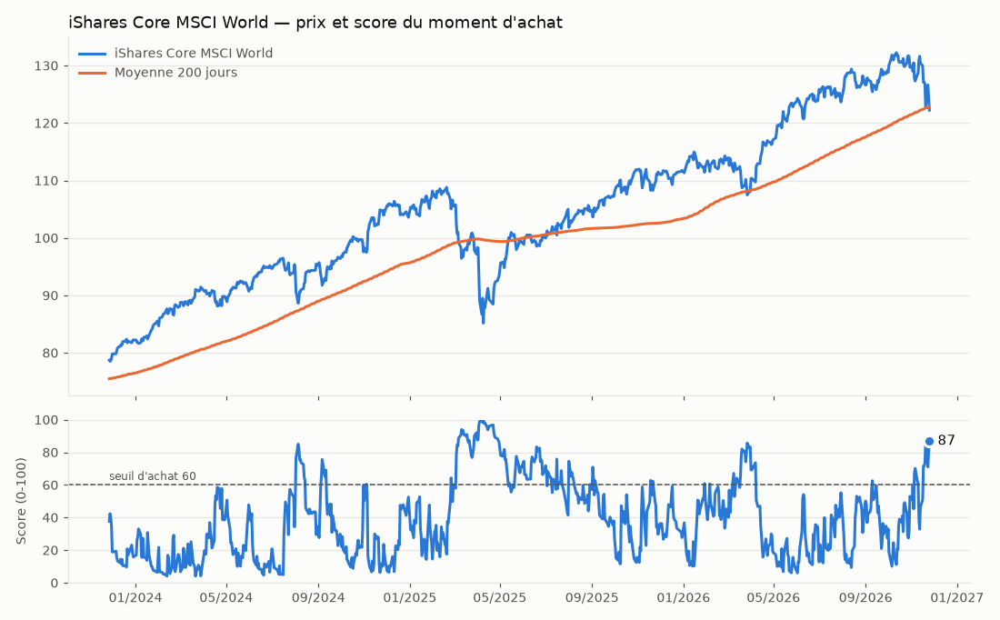

# Tableau de bord — 25/11/2026

⏳ Proposition en attente de votre réponse : ticket #139

Score du moment : **87/100 — 🟢 excellent moment (marché soldé)**. iShares Core MSCI World est à -7.6% de son plus haut sur 1 an, -0.4% par rapport à sa moyenne 200 jours, RSI 35.

Historiquement (^GSPC depuis 1950), quand le score était dans la tranche 80-100 (soldé) : **+10.4% en moyenne 12 mois plus tard**, positif dans 71% des cas (tous jours confondus : +9.3%, 74%).

## Portefeuille suivi

Portefeuille suivi : aucune position ; réserve 0 € ; en attente d'investissement 400 €. Valeur des positions : 0 €.

Apport mensuel : 200 € — proposé dès que le score atteint 60, au plus tard le 20 du mois.

## Statistiques du score

**^GSPC** :

| Score | Jours | Rendement moyen à 3 mois | à 12 mois | Positif à 12 mois | Pire cas à 12 mois |
|---|---:|---:|---:|---:|---:|
| 0-20 (cher) | 2 696 | +2.0% | +11.1% | 81% | -37.1% |
| 20-40 | 4 238 | +2.4% | +9.1% | 76% | -42.2% |
| 40-60 | 4 374 | +2.6% | +8.7% | 74% | -44.7% |
| 60-80 | 3 996 | +2.2% | +8.3% | 70% | -46.3% |
| **80-100 (soldé) ← aujourd'hui** | 3 094 | +1.8% | +10.4% | 71% | -48.8% |
| Tous les jours | 18 398 | +2.2% | +9.3% | 74% | -48.8% |

**Commandes** (en commentaire de n'importe quel ticket) :
- `oui` : j'ai passé les ordres proposés → le bot les enregistre
- `non` : je ne fais rien → le bot repropose dans 7 jours
- `apport 300` : changer l'apport mensuel (en €)
- `capital 2000` : ajouter une somme ponctuelle à investir
- `possede EUNL.DE 12` : déclarer des parts que vous avez déjà
- `aide` : afficher cette aide

#### 🔎 Radar (3063 actions et ETF suivis, 730 soldés aujourd'hui)
- ⭐ **Aurubis** (action, chercher « Aurubis ») — score **100/100**, -51% depuis son plus haut ; historiquement à ce niveau : +24% à 12 mois en moyenne, positif 72% des cas (moyenne du titre : +20% ; 6 épisode(s) indépendant(s))
  - 📰 🟠 raisons de la baisse déjà publiées : prévisions des analystes abaissées, résultats sous les attentes (pas une braderie sans raison) (3 mois : -35% vs marché)
    - 📉 [Aurubis Analysts Slash Price Targets as Richmond Ramp-Up Slips to Late 2028 - ad-hoc-news.de](https://news.google.com/rss/articles/CBMi4AFBVV95cUxNelhCWGliNDRMQUtYTk9VQm9GUE8zZ29NZFZDMkx2Y0ZXQVpyX1RvdjdfMUR0endqbXY2WVpUSnY5ZDJVcE5mV29kTmZ2NFZWeFJFYThhMEhZTVZfOXRqTTYtRWZ4RHNJbGlaaWtWWllKUGhWcC1GSjNISVQ5TEYwWlhQQTU1YkhXbVByRkRmUjZPRWIwRTlNTFhmaUE4NmxHQXI3dG9vUjRSZloxRU1VN0dLYW5SdGRxUmpIWmpvR1I5bFRDOS1peGRTZkRMNmMycGR6Q2hxTW84TUJOZ3BtLQ?oc=5) (prévisions des analystes abaissées)
    - 📉 [Aurubis sees 2026/27 profit below expectations due to US plant delay - TradingView](https://news.google.com/rss/articles/CBMi1AFBVV95cUxOOFRXXzJlUkRheHdlNVpNNGlxaGpfYWJxXzJELU5nRjFTb0JiUUludm5ELVJYckQxZkJ3SlVyd1hUa2ZXelpvWUw3Wm4xdjRHYzRMekRIWHAyMEpVVGp6a1JEd3JydUFLeVFfWndMUS0yMi1JWnBhOTlPSXJOeHJDd0hMZFJxUFBYUXhocUNtTGZYUE51VlFBTkFRZFNvd3JSUDZyWGRXZ2NJc0hWTTdIQ3F0eXhFQnhJNE9oV0dLcWNtS2NWWi1nWEdMVVlNVnlFX3lnSw?oc=5) (résultats sous les attentes)
    - 📉 [Aurubis stock: Richmond delays push outlook below expectations - ad-hoc-news.de](https://news.google.com/rss/articles/CBMiwgFBVV95cUxORzRrZ21sY2V6Z3VmWUo0YjZJRFgtamhvWkZySklFSFFTWE1yQ0lvdS1aMENqM0MzTDdQYkpGdDUwakd0WWRvLTZGZG5GcXJWRWo0aUJfak0wZGRGbGFVZ1c5dUJEMXNyZ0pDU082UEFHakFiWUg2V0hUVU51MVgyNzBPZURKOXZfWkxhR1B5WUswdUp3b1pVaTVJYVZxdUtHODJrZURuT1RjQ1pzRGpULXJlVDdsaXR6QUp2VVN6WmUwZw?oc=5) (résultats sous les attentes)
    - ⚠️ [European stock markets mostly lower, Aurubis plunges after profit warning - www.marketscreener.com](https://news.google.com/rss/articles/CBMiwwFBVV95cUxPNG5wT2JrQkhXblk3ZlAxQmw3LWd1cHhTeW4zSy1ibXV6bHl0VlpUN2tWU0RYVThKT1NLTkZDZ0FtanFyaVgzVl9MQ05sOExFbWh5M25nQVZlMGl5RjhHQk5zakh1b2RHSHVPOW5Vb05kR1hPZFA5aGIyaDZmakNEdDJqbHBTSWw1RGt2Sm10cEdyLXBlZHlDZUs3VHJxSkhtSmhoUERTTEhoVDJfNkEybHp5UW1WQmRsTXRRMmM1aUlZMEU?oc=5) (profit warning)
- ⭐ **The Andersons, Inc.** (action, chercher « The Andersons, Inc. ») — score **98/100**, -47% depuis son plus haut ; historiquement à ce niveau : +31% à 12 mois en moyenne, positif 70% des cas (moyenne du titre : +24% ; 5 épisode(s) indépendant(s))
  - 📰 🟠 raisons de la baisse déjà publiées : réaction à une acquisition (pas une braderie sans raison) (3 mois : -24% vs marché)
    - 📉 [The Andersons Inc. to acquire Harvestone Low Carbon Partners, expanding ethanol production capacity - Michigan Farm News](https://news.google.com/rss/articles/CBMiywFBVV95cUxQenlJd1pMMVo1Y2hOMVNBZV9zUzRnNXpDRUdvZ0MzMEZvZEMwUnZocXNybk9seFpzWUVSX0d6T2FBZ2RRQXN4RnA4OUNYeTV0MEFxZXNLd3dWazI5QWpfOU9mVTZNLUU3WDZpX1BxekthVmpSY0VEanY5ZFF2Y240N21QcGVXOHFUaVI1akh2MXlVenZfYjVaNk1fQ0t5TUFadE9La1hpTlNHVTViNk1Bdk5LWl9ZOGxtQXEzaUVSRUVyZ3hlY1hIc0poNA?oc=5) (réaction à une acquisition)
    - 📉 [The Andersons reports strong Q3 for ethanol, announces plans to acquire 3 additional ethanol plants - Ethanol Producer Magazine](https://news.google.com/rss/articles/CBMi0AFBVV95cUxQZ2Q5c09xMDVBRDh2YXotN3RrVjdCTU5TTVZ3OE5KcnF4bm1vQVRjTXgtbFZpLVRSVllZZ3BWT3BDVjdhOHNWb1RKRVJiYUFHRmFPeThWdjBzdjFxb1hTd0Z1Y21BQ0FwVDlfcFFEbXpUWi1tX1kwRXNHb2RFd3pUT3VVQzc4RnBpcW9mS1ZKb3JWelFhbkZnM25faV9FWWJfRms2RG80ZkpuUmVqeTRMMFlta3oxOXpzT1BfdWx0dFB6aVQySFo2czBnbjAyaVZS?oc=5) (réaction à une acquisition)
    - 📉 [The Andersons, Inc. to Acquire Harvestone Low Carbon Partners, Expanding Ethanol Production Capacity and Low-Carbon Fuels Capabilities - PR Newswire](https://news.google.com/rss/articles/CBMilgJBVV95cUxQcWRXWnZRaWp5MXl6ZVE0SU5pX0xnUlBXbllmTmZGcVdFTHVXYTM4YldOMVl0aWdwRVNzSWZ4MV9ISFNreU9JZFlHcUNjTGJrTE1JdzJ2WldsWXdHMWpxY0R3SFV5M0lseWNPYXl5UTFlNWRuWkN2UjJTNjJEc2NtNE90akJkeVJpUEdrS3MyUkVEZEZuRGVETzFvUHFOSkdlbUpyRVhHMVExS1hrQ01SUldZS2llenpXcVpNQzZpb0wyXzNQSkFhVmhpRmRyQ3JUQ3lQSDg2XzBaSS01RHlXN0NSb1dBU1FpVVlzMWF3NTFVWE5lTzRPRlJYcDJwTE1XcmhIbVdNTkpSbVpwMkJqUzhuaVFJdw?oc=5) (réaction à une acquisition)
- ⭐ **Sumitomo Metal Mining Co., Ltd.** (action, chercher « Sumitomo Metal Mining Co., Ltd. ») — score **98/100**, -54% depuis son plus haut ; historiquement à ce niveau : +37% à 12 mois en moyenne, positif 76% des cas (moyenne du titre : +21% ; 7 épisode(s) indépendant(s))
  - 📰 🟠 raisons de la baisse déjà publiées : réaction à une acquisition (pas une braderie sans raison) (3 mois : -41% vs marché)
    - 📉 [Sumitomo Metal Mining Co., Ltd. agreed to acquire 10% stake in Taganito HPAL Nickel Corporation from Nickel Asia Corporation. - www.marketscreener.com](https://news.google.com/rss/articles/CBMi4wFBVV95cUxOOXlTRG92ZVV3azkwejdVNWo4b1pXSVVDRjloaTRIQ3JvMlNFanlEbF9rX1U5eHowTnBtUm54Y1hVOGNtcmdxZWljZWdSQUVGbG9YM3pnbzZCRDhIdUdaR1AyR3dzVDdjaFg5aWlFZ0l1Nlp3S042WEo0OC1FYzhCaUhPVzRhemJWSWU4cXN1d3Jha2FYN2ZCeFcwWjRkMDhqVGZjRzNQR2JWeElaUEoxbFJwVFV6eHZuQlVjSlVQajJiM3FVcVZ6dm9HY0tFa2EzVkZ1YllwTDNPLUd1UEppRWFGdw?oc=5) (réaction à une acquisition)
- ⭐ **SCREEN Holdings** (action, chercher « SCREEN Holdings ») — score **98/100**, -63% depuis son plus haut ; historiquement à ce niveau : +34% à 12 mois en moyenne, positif 65% des cas (moyenne du titre : +27% ; 8 épisode(s) indépendant(s))
  - 📰 🟠 à vérifier : baisse bien plus forte que le marché, sans article inquiétant trouvé (3 mois : -38% vs marché)
- ⭐ **China Hongqiao Group** (action, chercher « China Hongqiao Group ») — score **98/100**, -56% depuis son plus haut ; historiquement à ce niveau : +52% à 12 mois en moyenne, positif 68% des cas (moyenne du titre : +39% ; 3 épisode(s) indépendant(s))
  - 📰 🟠 à vérifier : baisse bien plus forte que le marché, sans article inquiétant trouvé (3 mois : -19% vs marché)
- ⭐ **Toppan Printing Co., Ltd.** (action, chercher « Toppan Printing Co., Ltd. ») — score **98/100**, -41% depuis son plus haut ; historiquement à ce niveau : +22% à 12 mois en moyenne, positif 73% des cas (moyenne du titre : +10% ; 8 épisode(s) indépendant(s))
  - 📰 🟠 à vérifier : baisse bien plus forte que le marché, sans article inquiétant trouvé (3 mois : -22% vs marché)
- ⭐ **Sumitomo Electric Industries, Ltd.** (action, chercher « Sumitomo Electric Industries, Ltd. ») — score **98/100**, -62% depuis son plus haut ; historiquement à ce niveau : +41% à 12 mois en moyenne, positif 79% des cas (moyenne du titre : +21% ; 8 épisode(s) indépendant(s))
  - 📰 🟠 à vérifier : baisse bien plus forte que le marché, sans article inquiétant trouvé (3 mois : -31% vs marché)
- ⭐ **Antofagasta plc** (action, chercher « Antofagasta plc ») — score **97/100**, -44% depuis son plus haut ; historiquement à ce niveau : +29% à 12 mois en moyenne, positif 57% des cas (moyenne du titre : +23% ; 6 épisode(s) indépendant(s))
  - 📰 🟠 à vérifier : baisse bien plus forte que le marché, sans article inquiétant trouvé (3 mois : -32% vs marché)
- ⭐ **AeroVironment** (action, chercher « AeroVironment ») — score **97/100**, -77% depuis son plus haut ; historiquement à ce niveau : +27% à 12 mois en moyenne, positif 72% des cas (moyenne du titre : +21% ; 4 épisode(s) indépendant(s))
  - 📰 🟠 raisons de la baisse déjà publiées : repli de tout le secteur, résultats sous les attentes, recul malgré de bons résultats (pas une braderie sans raison) (3 mois : -32% vs marché)
    - 📉 [Red Cat Falls 6% as Post-Earnings Selloff Extends; Unusual Machines Slides 3%, AeroVironment Drops 2% - Yahoo Finance](https://news.google.com/rss/articles/CBMijgFBVV95cUxPSkRwTTBQbW83OENUcmRuZUpTV0FGTFI1d19EaVZBTFJxMGYtczNmTnUzeDlZSGRKOTFKZkdHS3hrc00xN3E3c2RBUllXY003VjlibkJCNmtNQ2hJeWlOakdiLUxqQTZNS1JIQ2Jib1VWZUlJVVg2WUxpak5ya3pOTl84cUFDWWdWUXNCWW1B?oc=5) (repli de tout le secteur)
    - 📉 [Red Cat Plunges 34% After Revenue Miss, Pulled Guidance and Needham Target Cut; Ondas and AeroVironment Dip - 24/7 Wall St.](https://news.google.com/rss/articles/CBMi4gFBVV95cUxPREV4SkRxVUtuZ2lLT25uQzB4X1NxOHhkczRFbHp1a2hycEdUNGRyZVZWdnFNdEFYUzRRT3lMczFYX1c5dkZCcTZuMnQ0OHIxX2UzWEZvNERfWWNtQXdXUzZuWTkxYmQwazcyNFFFWUhZd0ZNdFNTdFpTa2NvZ2lFX21sR1FZNFpaeHctOW9HN3NYdk4xR1h5SGhOS1J5MEtvMjhjMTBuWm1lcmxxNXlUQVBaeGJ2bWd4SkI4aTBvSkdQSUhoN0xCc1BtM0EwVDlqbGdLNHhzMHBXUTB5OE92T1lR?oc=5) (résultats sous les attentes)
    - 📉 [Ondas Retreats 5% Despite Record Revenue and Raised Outlook; Red Cat Drops 4%, AeroVironment Holds Steady - 24/7 Wall St.](https://news.google.com/rss/articles/CBMi3gFBVV95cUxPNTdLbVZjU2llZ0lRWEhUbE5Pb2pfSE1IN1p3YUZQaGRyaUxsQTJDX2NFSlpkWTljTVZFUHUyc05sbU9iSXVuaXR0eDlLb3YwaTQyWTJuZ3BoWmpjMU1BYmVoVTRXTEppWHZ3SXk3RlZxVmhBeDdBcXdQOGs2c01NN1E0eGNtaU56MXNTVk14a3JBUXVYaG9aZEdKOFFoSkVRbTBkVmhWc2pUOHY4YnZiYjhjNUwyc2tTWHpuVDFXdGxsVFNiUlltUEhMVkRubnU1eEczU1lJSVlRSkVaNlE?oc=5) (recul malgré de bons résultats)
- ⭐ **Texas Pacific Land Corporation** (action, chercher « Texas Pacific Land Corporation ») — score **97/100**, -51% depuis son plus haut ; historiquement à ce niveau : +46% à 12 mois en moyenne, positif 75% des cas (moyenne du titre : +41% ; 6 épisode(s) indépendant(s))
  - 📰 🟠 raisons de la baisse déjà publiées : réaction à une acquisition (pas une braderie sans raison) (3 mois : -20% vs marché)
    - 📉 [Sidley Represents Texas Pacific Land in US$3.0 Billion Acquisition of EagleRock - Legal Desire](https://news.google.com/rss/articles/CBMipgFBVV95cUxNQUdwUHJqWlZDMG5UUWs1R0VsalJ1RDNfU2VWZUs4a2g2aF96RllXM2ZMVE5YbFJGTm5SS2QzRmg4TkdyU08xbzN6cFFUakRkQ0RFbW93RUNHNlFhZGY4bl9uNjJYQ2psMWxkeE1vYXQyTW12T21MVzEzLVVjMWxxdWpzcEpvak41bmYtcVdDb1Z2Q0VjZG9WS0lkbXpROGhudFVjVEVB?oc=5) (réaction à une acquisition)
    - 📉 [Texas Pacific Land to Acquire EagleRock in All-Stock Transaction, Expected to Enhance the Permian Basin’s Premier Land, Water and Royalty Platform - BOE Report](https://news.google.com/rss/articles/CBMiiAJBVV95cUxQZ2RZTFpXZnM2OFZvdHd1R3hNc19rM0Y4anhFa2cwb3FBbVhNbDBTbVh4MkFwQ3RwcmRBZFpSRUlpWWUxNklTQkVJdzdxYVk5UVBKS0JEZDczTEJNcHRmNzlUYVZKS1YyN2hVX0Z6cm44ZUVyMTNHblhQRURHVlp0VDcza0VpLUthWEZBV0lrRXBHWXJ4ZG5SaDFjNnhZVnN1MmZGVC1SMXJSSFc3cHZxV3h1R1BQb2VwY1dYYVdsWExwR2ZMRC02Zjc2b1VnUHFUYnZhejFMMHAzQXhVV25HMTR4OGxlaEI2ZlZGME84UkNyVkszQkMxdG1qNlJqMmNSSjl3UFNrR2rSAY4CQVVfeXFMTnZMU1dVZ201S3RWWEFOa0ZBSEtaemsxZk00VFFfam1BLXRHYmF3QjEycUhDeWkzYmY2Y214REs2UjRrNWw0LW15UVNDblJ1M3hvNF9oZGRseW9DcmJWREFFRmcxRThNcy1kQzhOZks1OHp2OGpDNlhnZW40SkdBWm5MakZUMjFTWDlyQWRfSFU5d1hUQzhoeDk1a25RR3V5YkxTNW9yYURSQWd2bTNlMVZWdE9rbjJQLW1nQlo0SG93aFV0RXlYRTU1OEQyeFNxdno5Q29JdFlYTElQMTZpYkpaZkFZVTRhNUJTWnZjRmtaREtoTDNOdDFCQWZKaG9Xdl81b2dQN3plRVNOY3Fn?oc=5) (réaction à une acquisition)
    - 📉 [Texas Pacific Land to Acquire EagleRock in $3 Billion All-Stock Transaction - citybiz](https://news.google.com/rss/articles/CBMiswFBVV95cUxNNzRIbjYwd0ppaXE3TnpJTFRyeFdIVFBFbjF5U0Y4alQ3NXFXbmlLYktTOWxtLVQ3VnFxR00wc3R3OWpZU1EwRk1VMWFOZXdDWmJ2RDd0ZWtYNF9qc0huVExOUEZrY2dsd09KNXBSRnM2ZldKclRsU200OU9ZRlVWYUk1SV9kLXJCWkR5aXBzam5WcnFiMXdhZXVmNUU1ZjdTZjlXVFNTUllDMGFzQTBSVkNTSQ?oc=5) (réaction à une acquisition)
- ⭐ **Norsk Hydro** (action, ISIN `NO0005052605`) — score **97/100**, -47% depuis son plus haut ; historiquement à ce niveau : +22% à 12 mois en moyenne, positif 61% des cas (moyenne du titre : +20% ; 5 épisode(s) indépendant(s))
  - 📰 🟠 à vérifier : baisse bien plus forte que le marché, sans article inquiétant trouvé (3 mois : -26% vs marché)
- ⭐ **ESCO Technologies Inc.** (action, chercher « ESCO Technologies Inc. ») — score **97/100**, -40% depuis son plus haut ; historiquement à ce niveau : +17% à 12 mois en moyenne, positif 72% des cas (moyenne du titre : +16% ; 7 épisode(s) indépendant(s))
  - 📰 🟢 rien d'alarmant dans l'actualité (3 mois : -15% vs marché)
    - 📉 [Deutsche Bank Lowers Price Target on ESCO Technologies to $311 From $331, Keeps Buy Rating - marketscreener.com](https://news.google.com/rss/articles/CBMi1wFBVV95cUxQVVA1bmZ0UmNuak5vTUZidkp1bElHMDFiMXVOOWVUZzdHck9QVUoxRnpGRFdpeGZ1SGdTdlExemFWZTAtUm9WUS1mZzg4M3ExVWJON3RVc3o3TVhPYUZ6QnBvMDV6RFBmLWZGY3E5eGQwUUVWZ0g1RGVzeUZFZ04xWHZjZGdXRXNRTHhLV1FPT09ydU5BM2tJR0hIU2cxajdpaVAyZ2JkUTVqX3FwZHJTbFBmdTZlUE5iOTNKLXpNVVNTVDlzblU1bkdja2V6ekpMcXk2ZkpzQQ?oc=5) (objectifs de cours abaissés)
- ⭐ **Eagers Automotive** (action, chercher « Eagers Automotive ») — score **97/100**, -50% depuis son plus haut ; historiquement à ce niveau : +42% à 12 mois en moyenne, positif 68% des cas (moyenne du titre : +28% ; 7 épisode(s) indépendant(s))
  - 📰 🟠 raisons de la baisse déjà publiées : réaction à une acquisition, marges sous pression, réaction excessive du marché (pas une braderie sans raison) (3 mois : -30% vs marché)
    - 📉 [Eagers Automotive Agrees to Acquire California Multi-Franchise Dealership Group with AUD $450 Million Annual Turnover - Kalkine](https://news.google.com/rss/articles/CBMi7wFBVV95cUxPWlZBdVBWN1ZlWmcyMjdBQnFYZW5fTEdTRzdWOWZ5Z2VsOTVLTmwxamczLVN3LVc2dl9VOTRjT1kzcXUtT3E3U1JhVE1EdFZFVlhHTXRnUVduMmlFRm1GcjZxS3BUWXNPOHFBN0tjX3Q0Rm5KUUx2X3NxODh1cXhqZm90bHYtTzZOYWxiWjZXRjJfbWlpV2NqM3JrMmZ5MTh0WmdQMmpBWVN0OVJvZTlmWncxRmduRE0zSXoxQ2tNTUhMcS1rVVBLSFlCU2xHanR6N1lSMFZOM1htQXNNb1RITWZwUk5UTHlhaEh2QTdFaw?oc=5) (réaction à une acquisition)
    - 📉 [How Eagers Automotive (ASX:APE) is leaning on acquisitions as the ASX 200 car retailer faces margin pressure - Kalkine](https://news.google.com/rss/articles/CBMi1wFBVV95cUxPRU1lTWpoLXpONWtqWWdHM2tFUGpTWkh5RXlSRzBnaXpOeEF6NkxYdW0yZVBkWXZpNnpQcHVSZkpxOV9zdU5WbzZYT2pFbkJibUwtT0VQcHQtWVZOcFRJbmFvUU9HWC1meGUtT3NVUTRTV2JMcUtoZDRoVFRlQzJ0QXEySEFmTHl1Y1doRHV1MnZnTG9LcTRTWnVtR0daaWRZalQ5TzM5Vk1kX2E2R0d2cVZUZ2JKeUk4aTI3QVRyZGZOR2VKb0VLenhGM0dWVDFHQUZGU1pqTQ?oc=5) (marges sous pression)
    - 📉 [Eagers Automotive Shares Flash Oversold, At 52 Week Low - TheBull.com.au](https://news.google.com/rss/articles/CBMiiwFBVV95cUxQbi1CVHZKa0p5d0JwRzMyS3JnVGw5dl9jNFBNSnZKdnFmb1ZFTjRmNnd3dmpxYWRiYk5mQ0VybkplaUxIM09saGU4Q0xXTzRxVDY1SmdpYWFqM2VNM1pFZXBxSERFQm1SWEJsQ1c0eHlVMmFFWjFIbmJoSTg5UHpnMk5Pb20yVVlLRVRB?oc=5) (réaction excessive du marché)
- ⭐ **Broadcom** (action, chercher « Broadcom ») — score **96/100**, -37% depuis son plus haut ; historiquement à ce niveau : +57% à 12 mois en moyenne, positif 100% des cas (moyenne du titre : +49% ; 4 épisode(s) indépendant(s))
  - 📰 🟢 rien d'alarmant dans l'actualité (1 article(s) mineur(s), courant pour une grande entreprise) (3 mois : -9% vs marché)
    - 📉 [Broadcom Sinks 15% in a Week to a 52-Week Low as Google Reportedly Cuts TPU Orders. Is the Selling Overdone? - TIKR.com](https://news.google.com/rss/articles/CBMi4AFBVV95cUxNMEVsTW5RajhCaHdIT1JkM1NoQTZUdmhlcXBBOHhXLXhzeDhzeXR3b0RmUEFnSFlkNWJ2cEJrcTNLMU5sWlFSMG42dERJZ1hwdWo1dU1aU3o1aTF2aEJPNU1JbENmMG5ndzQzTERvSVJSSTFDd1RfUDN4ejF6YUp5Skl0WmFSWGRpVk15d0FsbG5PQTk3QlNha2d0bjNORG5IZnUzMEQ3SWM2OUxGd1AwZVV6ZVJOYWhZcld6UUVZUHNra2JQcnM5Nm41Z2dLUEFpU21NaGZ4bEY5aFhOVmlvdQ?oc=5) (réaction excessive du marché)
    - 📉 [Broadcom: The Google Scare Is Overdone - Seeking Alpha](https://news.google.com/rss/articles/CBMihAFBVV95cUxNdUF3VUlRdS04S09Pd1UwaWlMaXdtX2gyREFGQ1MyTmNEa19tT2J6MnctTEl5ejZqdjFaMkhfdVhMVTdzSV9KTFBQVFpBZlQza05fenQzWVdCWlMzWndoOXhFci0xNUJqdmJsVUVEaU12anR1cTlLcktQWTBMVTRIY3EwTTk?oc=5) (réaction excessive du marché)
    - 📉 [Not Micron. Not Broadcom. This Is My Top Oversold Artificial Intelligence (AI) Stock to Buy in December - The Motley Fool](https://news.google.com/rss/articles/CBMi2gFBVV95cUxQM3dkSXVjdmUxOExWZmdRZDhvcC1Rc29Dc3I2aTM4UFZGYmdBdzFLWmJtWFE2amlWdFkya0d5Tjk3V25jelFad01uekJocml0T3pyeGk0ckFrbDU1TWFnbk9NS1llNjBraDlWMnVSREZNTHBvM3g3czkxbS1yQ2pfYUsteUhKLVRSN2FFZVVKM1ZHQTZYYmJpVWhCa09UcTZhVy1RN1Vrd2w2bG1oVDJFLUZiTE5LcUZWX0pqRXBmMFBsbnJBeTE5WlhpRkxQS0NLRUNrSUFHZjB5UQ?oc=5) (réaction excessive du marché)
    - ⚠️ [Why Redburn Downgraded Broadcom (AVGO) Despite 221% AI Growth - Yahoo Finance](https://news.google.com/rss/articles/CBMiowFBVV95cUxPcHhKYllwc0kwNzhwd3FOMUJ6LXlhSXZiUTJyeGFKX25PZ2pVYVNEYWpZNnpiY0tucWZQeDVDRUQ1M1BNRkNBS0lybXFzSy10ekVJY2U3eFU5OE4wMjlTeXJPRklzYnVUc250VDFEak5qWlJJNXNrUnVVeWRaVlBEdjFoSzVlNGRfcmVfNHR0ZzhwOGd4OE1UUmNiN3BQemgxd25B?oc=5) (downgraded)
- ⭐ **Kaiser Aluminum Corporation** (action, chercher « Kaiser Aluminum Corporation ») — score **96/100**, -51% depuis son plus haut ; historiquement à ce niveau : +35% à 12 mois en moyenne, positif 74% des cas (moyenne du titre : +16% ; 4 épisode(s) indépendant(s))
  - 📰 🟠 à vérifier : baisse bien plus forte que le marché, sans article inquiétant trouvé (3 mois : -31% vs marché)
- ⭐ **Rio Tinto** (action, ISIN `GB0007188757`) — score **96/100**, -33% depuis son plus haut ; historiquement à ce niveau : +30% à 12 mois en moyenne, positif 73% des cas (moyenne du titre : +14% ; 6 épisode(s) indépendant(s))
- ⭐ **Rohm Co., Ltd.** (action, chercher « Rohm Co., Ltd. ») — score **96/100**, -55% depuis son plus haut ; historiquement à ce niveau : +26% à 12 mois en moyenne, positif 67% des cas (moyenne du titre : +10% ; 8 épisode(s) indépendant(s))
- ⭐ **EnerSys** (action, chercher « EnerSys ») — score **96/100**, -47% depuis son plus haut ; historiquement à ce niveau : +47% à 12 mois en moyenne, positif 82% des cas (moyenne du titre : +20% ; 5 épisode(s) indépendant(s))
- ⭐ **Primoris Services Corporation** (action, chercher « Primoris Services Corporation ») — score **96/100**, -72% depuis son plus haut ; historiquement à ce niveau : +33% à 12 mois en moyenne, positif 64% des cas (moyenne du titre : +25% ; 4 épisode(s) indépendant(s))
- ⭐ **The Furukawa Electric Co., Ltd.** (action, chercher « The Furukawa Electric Co., Ltd. ») — score **96/100**, -72% depuis son plus haut ; historiquement à ce niveau : +46% à 12 mois en moyenne, positif 53% des cas (moyenne du titre : +30% ; 6 épisode(s) indépendant(s))
- ⭐ **Zijin Mining** (action, chercher « Zijin Mining ») — score **96/100**, -48% depuis son plus haut ; historiquement à ce niveau : +35% à 12 mois en moyenne, positif 66% des cas (moyenne du titre : +29% ; 6 épisode(s) indépendant(s))
- ⭐ **Dycom Industries** (action, chercher « Dycom Industries ») — score **96/100**, -67% depuis son plus haut ; historiquement à ce niveau : +35% à 12 mois en moyenne, positif 57% des cas (moyenne du titre : +27% ; 8 épisode(s) indépendant(s))
- ⭐ **Caterpillar Inc.** (action, chercher « Caterpillar Inc. ») — score **96/100**, -49% depuis son plus haut ; historiquement à ce niveau : +32% à 12 mois en moyenne, positif 76% des cas (moyenne du titre : +24% ; 7 épisode(s) indépendant(s))
- ⭐ **BWX Technologies** (action, chercher « BWX Technologies ») — score **96/100**, -52% depuis son plus haut ; historiquement à ce niveau : +29% à 12 mois en moyenne, positif 83% des cas (moyenne du titre : +23% ; 3 épisode(s) indépendant(s))
- ⭐ **Sterling Infrastructure** (action, chercher « Sterling Infrastructure ») — score **96/100**, -74% depuis son plus haut ; historiquement à ce niveau : +70% à 12 mois en moyenne, positif 78% des cas (moyenne du titre : +47% ; 6 épisode(s) indépendant(s))
- ⭐ **Adeia, Inc.** (action, chercher « Adeia, Inc. ») — score **95/100**, -58% depuis son plus haut ; historiquement à ce niveau : +26% à 12 mois en moyenne, positif 65% des cas (moyenne du titre : +14% ; 6 épisode(s) indépendant(s))
- ⭐ **Intel** (action, chercher « Intel ») — score **95/100**, -61% depuis son plus haut ; historiquement à ce niveau : +33% à 12 mois en moyenne, positif 71% des cas (moyenne du titre : +17% ; 6 épisode(s) indépendant(s))
- ⭐ **Fidelity Emerging Markets** (action, chercher « Fidelity Emerging Markets ») — score **95/100**, -32% depuis son plus haut ; historiquement à ce niveau : +17% à 12 mois en moyenne, positif 69% des cas (moyenne du titre : +14% ; 9 épisode(s) indépendant(s))
- ⭐ **SoftBank Group** (action, ISIN `JP3436100006`) — score **95/100**, -67% depuis son plus haut ; historiquement à ce niveau : +57% à 12 mois en moyenne, positif 79% des cas (moyenne du titre : +34% ; 6 épisode(s) indépendant(s))
- ⭐ **StoneX Group Inc.** (action, chercher « StoneX Group Inc. ») — score **95/100**, -61% depuis son plus haut ; historiquement à ce niveau : +58% à 12 mois en moyenne, positif 95% des cas (moyenne du titre : +36% ; 7 épisode(s) indépendant(s))
- ⭐ **Prysmian** (action, ISIN `IT0004176001`) — score **95/100**, -41% depuis son plus haut ; historiquement à ce niveau : +40% à 12 mois en moyenne, positif 81% des cas (moyenne du titre : +21% ; 6 épisode(s) indépendant(s))
- ⭐ **Yara International** (action, chercher « Yara International ») — score **95/100**, -34% depuis son plus haut ; historiquement à ce niveau : +27% à 12 mois en moyenne, positif 81% des cas (moyenne du titre : +15% ; 4 épisode(s) indépendant(s))
- ⭐ **Lam Research** (action, chercher « Lam Research ») — score **95/100**, -57% depuis son plus haut ; historiquement à ce niveau : +63% à 12 mois en moyenne, positif 84% des cas (moyenne du titre : +36% ; 8 épisode(s) indépendant(s))
- ⭐ **Schneider Electric** (action, ISIN `FR0000121972`) — score **95/100**, -30% depuis son plus haut ; historiquement à ce niveau : +28% à 12 mois en moyenne, positif 81% des cas (moyenne du titre : +17% ; 10 épisode(s) indépendant(s))
- ⭐ **Weir** (action, chercher « Weir ») — score **95/100**, -42% depuis son plus haut ; historiquement à ce niveau : +30% à 12 mois en moyenne, positif 64% des cas (moyenne du titre : +19% ; 8 épisode(s) indépendant(s))
- ⭐ **Cummins** (action, chercher « Cummins ») — score **95/100**, -42% depuis son plus haut ; historiquement à ce niveau : +50% à 12 mois en moyenne, positif 88% des cas (moyenne du titre : +30% ; 7 épisode(s) indépendant(s))
- ⭐ **IG Group** (action, chercher « IG Group ») — score **95/100**, -52% depuis son plus haut ; historiquement à ce niveau : +21% à 12 mois en moyenne, positif 75% des cas (moyenne du titre : +12% ; 5 épisode(s) indépendant(s))
- ⭐ **Kratos Defense & Security Solutions** (action, chercher « Kratos Defense & Security Solutions ») — score **95/100**, -78% depuis son plus haut ; historiquement à ce niveau : +31% à 12 mois en moyenne, positif 60% des cas (moyenne du titre : +14% ; 7 épisode(s) indépendant(s))
- ⭐ **Elmos Semiconductor SE** (action, chercher « Elmos Semiconductor SE ») — score **94/100**, -54% depuis son plus haut ; historiquement à ce niveau : +115% à 12 mois en moyenne, positif 93% des cas (moyenne du titre : +26% ; 9 épisode(s) indépendant(s))
- ⭐ **Curtiss-Wright** (action, chercher « Curtiss-Wright ») — score **94/100**, -44% depuis son plus haut ; historiquement à ce niveau : +23% à 12 mois en moyenne, positif 78% des cas (moyenne du titre : +22% ; 7 épisode(s) indépendant(s))
- ⭐ **Pan American Silver Corp.** (action, chercher « Pan American Silver Corp. ») — score **94/100**, -49% depuis son plus haut ; historiquement à ce niveau : +26% à 12 mois en moyenne, positif 54% des cas (moyenne du titre : +19% ; 3 épisode(s) indépendant(s))
- ⭐ **First Majestic Silver Corp.** (action, chercher « First Majestic Silver Corp. ») — score **94/100**, -62% depuis son plus haut ; historiquement à ce niveau : +86% à 12 mois en moyenne, positif 48% des cas (moyenne du titre : +58% ; 5 épisode(s) indépendant(s))
- ⭐ **Standex International Corporation** (action, chercher « Standex International Corporation ») — score **94/100**, -40% depuis son plus haut ; historiquement à ce niveau : +43% à 12 mois en moyenne, positif 77% des cas (moyenne du titre : +18% ; 6 épisode(s) indépendant(s))
- ⭐ **Droneshield** (action, chercher « Droneshield ») — score **94/100**, -77% depuis son plus haut ; historiquement à ce niveau : +181% à 12 mois en moyenne, positif 82% des cas (moyenne du titre : +82% ; 3 épisode(s) indépendant(s))
- ⭐ **Alphabet Inc. (Class C)** (action, chercher « Alphabet Inc. (Class C) ») — score **94/100**, -32% depuis son plus haut ; historiquement à ce niveau : +30% à 12 mois en moyenne, positif 75% des cas (moyenne du titre : +23% ; 6 épisode(s) indépendant(s))
- ⭐ **iShares Core MSCI EM IMI** (ETF, ISIN `IE00BKM4GZ66`) — score **94/100**, -20% depuis son plus haut ; historiquement à ce niveau : +13% à 12 mois en moyenne, positif 78% des cas (moyenne du titre : +8% ; 3 épisode(s) indépendant(s))
- ⭐ **Applied Materials** (action, chercher « Applied Materials ») — score **94/100**, -57% depuis son plus haut ; historiquement à ce niveau : +57% à 12 mois en moyenne, positif 92% des cas (moyenne du titre : +25% ; 8 épisode(s) indépendant(s))
- ⭐ **Oracle Corporation** (action, chercher « Oracle Corporation ») — score **94/100**, -58% depuis son plus haut ; historiquement à ce niveau : +34% à 12 mois en moyenne, positif 98% des cas (moyenne du titre : +15% ; 9 épisode(s) indépendant(s))
- ⭐ **Eaton Corporation** (action, chercher « Eaton Corporation ») — score **94/100**, -31% depuis son plus haut ; historiquement à ce niveau : +28% à 12 mois en moyenne, positif 76% des cas (moyenne du titre : +21% ; 5 épisode(s) indépendant(s))
- ⭐ **Hecla Mining** (action, chercher « Hecla Mining ») — score **94/100**, -65% depuis son plus haut ; historiquement à ce niveau : +50% à 12 mois en moyenne, positif 61% des cas (moyenne du titre : +27% ; 7 épisode(s) indépendant(s))
- ⭐ **NexGen Energy Ltd.** (action, chercher « NexGen Energy Ltd. ») — score **94/100**, -47% depuis son plus haut ; historiquement à ce niveau : +56% à 12 mois en moyenne, positif 63% des cas (moyenne du titre : +35% ; 3 épisode(s) indépendant(s))
- ⭐ **Del Monte Corporation** (action, chercher « Del Monte Corporation ») — score **94/100**, -40% depuis son plus haut ; historiquement à ce niveau : +15% à 12 mois en moyenne, positif 63% des cas (moyenne du titre : +8% ; 7 épisode(s) indépendant(s))
- ⭐ **Murata Manufacturing Co., Ltd.** (action, chercher « Murata Manufacturing Co., Ltd. ») — score **94/100**, -61% depuis son plus haut ; historiquement à ce niveau : +40% à 12 mois en moyenne, positif 77% des cas (moyenne du titre : +19% ; 6 épisode(s) indépendant(s))
- ⭐ **Fabrinet** (action, chercher « Fabrinet ») — score **94/100**, -61% depuis son plus haut ; historiquement à ce niveau : +82% à 12 mois en moyenne, positif 96% des cas (moyenne du titre : +37% ; 4 épisode(s) indépendant(s))
- ⭐ **Bunge Global** (action, chercher « Bunge Global ») — score **94/100**, -32% depuis son plus haut ; historiquement à ce niveau : +23% à 12 mois en moyenne, positif 70% des cas (moyenne du titre : +11% ; 3 épisode(s) indépendant(s))
- ⭐ **Bilfinger** (action, chercher « Bilfinger ») — score **94/100**, -55% depuis son plus haut ; historiquement à ce niveau : +26% à 12 mois en moyenne, positif 59% des cas (moyenne du titre : +17% ; 5 épisode(s) indépendant(s))
- ⭐ **Mercury General** (action, chercher « Mercury General ») — score **94/100**, -26% depuis son plus haut ; historiquement à ce niveau : +21% à 12 mois en moyenne, positif 68% des cas (moyenne du titre : +12% ; 5 épisode(s) indépendant(s))
- ⭐ **Alphabet (Google)** (action, ISIN `US02079K3059`) — score **94/100**, -32% depuis son plus haut ; historiquement à ce niveau : +30% à 12 mois en moyenne, positif 75% des cas (moyenne du titre : +23% ; 6 épisode(s) indépendant(s))
- ⭐ **Ebara Corp.** (action, chercher « Ebara Corp. ») — score **94/100**, -53% depuis son plus haut ; historiquement à ce niveau : +39% à 12 mois en moyenne, positif 80% des cas (moyenne du titre : +22% ; 8 épisode(s) indépendant(s))
- ⭐ **TTM Technologies** (action, chercher « TTM Technologies ») — score **94/100**, -74% depuis son plus haut ; historiquement à ce niveau : +60% à 12 mois en moyenne, positif 84% des cas (moyenne du titre : +24% ; 8 épisode(s) indépendant(s))
- … et 670 autres.
⭐ = historiquement, acheter ce titre à ce niveau de score a fait mieux que sa moyenne.
