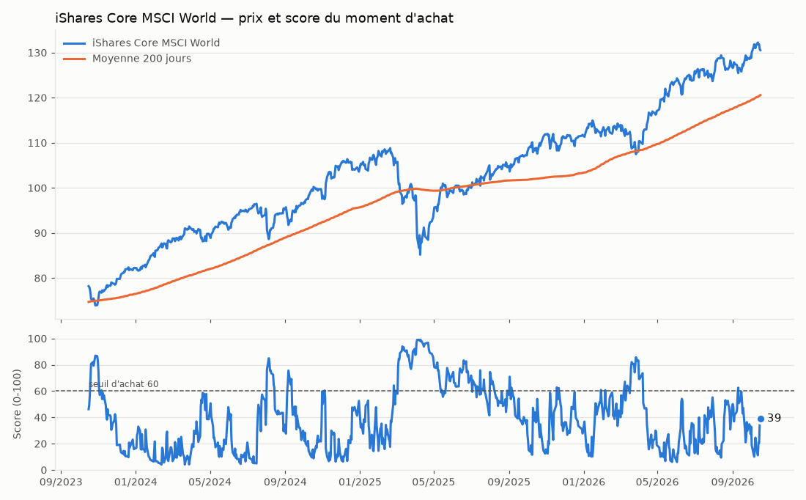

# Tableau de bord — 19/10/2026

✅ Rien à faire aujourd'hui : le bot attend le meilleur moment.

Score du moment : **37/100 — 🟠 marché plutôt cher**. iShares Core MSCI World est à -1.2% de son plus haut sur 1 an, +8.3% par rapport à sa moyenne 200 jours, RSI 56.

Historiquement (^GSPC depuis 1950), quand le score était dans la tranche 20-40 : **+9.1% en moyenne 12 mois plus tard**, positif dans 76% des cas (tous jours confondus : +9.3%, 74%).

## Portefeuille suivi

Portefeuille suivi : aucune position ; réserve 0 € ; en attente d'investissement 200 €. Valeur des positions : 0 €.

Apport mensuel : 200 € — proposé dès que le score atteint 60, au plus tard le 20 du mois.

## Statistiques du score

**^GSPC** :

| Score | Jours | Rendement moyen à 3 mois | à 12 mois | Positif à 12 mois | Pire cas à 12 mois |
|---|---:|---:|---:|---:|---:|
| 0-20 (cher) | 2 692 | +2.0% | +11.1% | 81% | -37.1% |
| **20-40 ← aujourd'hui** | 4 225 | +2.4% | +9.1% | 76% | -42.2% |
| 40-60 | 4 365 | +2.6% | +8.7% | 74% | -44.7% |
| 60-80 | 3 995 | +2.2% | +8.3% | 70% | -46.3% |
| 80-100 (soldé) | 3 094 | +1.8% | +10.4% | 71% | -48.8% |
| Tous les jours | 18 371 | +2.2% | +9.3% | 74% | -48.8% |

**Commandes** (en commentaire de n'importe quel ticket) :
- `oui` : j'ai passé les ordres proposés → le bot les enregistre
- `non` : je ne fais rien → le bot repropose dans 7 jours
- `apport 300` : changer l'apport mensuel (en €)
- `capital 2000` : ajouter une somme ponctuelle à investir
- `possede EUNL.DE 12` : déclarer des parts que vous avez déjà
- `aide` : afficher cette aide

#### 🔎 Radar (3064 actions et ETF suivis, 640 soldés aujourd'hui)
- ⭐ **AeroVironment** (action, chercher « AeroVironment ») — score **99/100**, -70% depuis son plus haut ; historiquement à ce niveau : +27% à 12 mois en moyenne, positif 72% des cas (moyenne du titre : +21%)
  - 📰 🟠 à vérifier : baisse bien plus forte que le marché, sans article inquiétant trouvé (3 mois : -23% vs marché)
- ⭐ **IG Group** (action, chercher « IG Group ») — score **99/100**, -50% depuis son plus haut ; historiquement à ce niveau : +21% à 12 mois en moyenne, positif 75% des cas (moyenne du titre : +12%)
  - 📰 🟠 à vérifier : baisse bien plus forte que le marché, 3 article(s) à regarder (3 mois : -48% vs marché)
    - ⚠️ [IG Group shares plunge 25% as Peel Hunt flags revenue and margin downgrade - Proactive financial news](https://news.google.com/rss/articles/CBMi3AFBVV95cUxOTzNoQXR4UUZkR19URmlSWXFFNWxsSE4tVlZLTVRuMDdpRXEwLThnYW5WS2JMdlJFbWhHamJkd0p0Q0RCYmZwYXZ3bHdOTV90Rk1WRTJSaElNakdiWW0xalJVMkYybEVLU0ZYblRxbnd5dkRDQlJUUzJrd1VfUnM5OGZpSmNpd0xkck5fbVppbFZnTGU3dzNpSktwNW41VV9taUhsZjM1NFEzLTFsY19EcDNFaDc1S2huSW5Ddk9GRGRRQVhndU1fcHpNX0M2cWZfYnBBNk42QmJJcDJJ?oc=5) (downgrade)
    - ⚠️ [IG Group (LSE:IGG) Bounces Back: Has The Market Moved Past The Profit Warning Shock Today? - Kalkine Media](https://news.google.com/rss/articles/CBMiygFBVV95cUxPa2FyMzFFRTUxWFI4RHhvMmh0S21QM1BMN3F6Q3UtWFZYVV9EM1NZV240SUJ2cExoTzBxaUNzY1RycTRlSFBKSjRDLWE3VXlnZE9RRVNlQnBPNTY0UzlOYVIxd2Z5QjN1MGRlRFZXTDFLTmVrWFBnRl90MVdPTnJsWFBGOTAyNmtXWW8tUGsxT0xRM3NCOU45S3hLZkhwRk1HWDR6OEUxVWI0OGptQ19Wd0tVWU83NVVFSTBqWjN5UEVNTldFdE9oa3dB?oc=5) (profit warning)
    - ⚠️ [What IG Group Holdings (LSE:IGG)'s Revenue Guidance Cut Means For Shareholders - Simply Wall Street](https://news.google.com/rss/articles/CBMi6AFBVV95cUxNTjJqZ1o4Vl95QmNKYjhXVkZxSG9fSGdtOER5TFZWb3A2TnFFaDYtNVZkSnpOc2szS2RJdHZCQXdvWFJ6Q1VDd0ljVEJOQUZPVHpmSmxOVDg5SzhUWnNKYzJFam81SXphV0lUZGtmTmwzaVl2UzBEOFhDc2FQSXpNeWRlZlI3UE43NVJ6bmp4NEF6enU1OEJvZXJGNW5fU2lhWmdiQU9DN2hWdXUtanFObHZXV1pkVVMtTmdyamVORDVOTmZXd1BDd1duOUFRNHNxeVRVRkQ2NTJVUmQ1Y0pZU09sc0FuX2JZ0gHuAUFVX3lxTFBaaWZrdHNjY3VONEZvNzRtMmVPSnlWemF3OUMxZnBseHBXV1JIWGJoX2tXOEgzQXpMZjNrbkM0dzV2aGYycld2d0xFQk4tQjdscmFWalJHbEM2QmdqWkhaX3RhaHgtVXc4dUVCYnB2OFpLNnVueVVva3R0VlpVSTJBZGthdWc2VGNwQktrX1FpcmpzQjlmc0NPODVXTWZMMmtFNTNNMGhacjg0SDR1LTg3YTVFcHhrNjhWenZfOE1Bd180d2lFOS1PdzBHd2IyNVBVelgxR1FoZGFGeGR5WUNXUUNTMkFmNm9BUlY5SUE?oc=5) (guidance cut)
- ⭐ **Curtiss-Wright** (action, chercher « Curtiss-Wright ») — score **98/100**, -37% depuis son plus haut ; historiquement à ce niveau : +23% à 12 mois en moyenne, positif 78% des cas (moyenne du titre : +22%)
  - 📰 🟠 à vérifier : baisse bien plus forte que le marché, 2 article(s) à regarder (3 mois : -34% vs marché)
    - ⚠️ [Curtiss-Wright (NYSE:CW) Stock Drops 9% Today After CFO Steps Down - kalkine.ca](https://news.google.com/rss/articles/CBMingFBVV95cUxQU3BUbVZZY3RCVTA3Vk5vVWhTMkZySTBfTGtkdllaN25VRk9QcldJTk9Tdk0tTEhmYU5aZURSNWtYbHZOdk5FWUV6ZHVjU3dPNTdtdGVBVXBpVVEtVUR6UW1ZXzlHRXhMYUhrWEdPdUozUGpnWFV1bk9jVGhubFhKT0t1eTN5a29VYTI3VXIxNHpod1lBM09MSjVwaDI4QQ?oc=5) (steps down)
    - ⚠️ [Curtiss-Wright (NYSE:CW) Sets New 52-Week Low Following Analyst Downgrade - MarketBeat](https://news.google.com/rss/articles/CBMiywFBVV95cUxQYXljNS1Xa1F2QmpjU29Mclg2T1JvMGRCVGRUZnAwTGFEUVFrMTZEbGlhVmpncW80LVVRbzg0V0RaWE5fOVF5bmxfVHQ2Q0pTUnNHenF5UDg4VmJhel9yS2JvZ3hXTlF1N2lOTmQzT0NIVHVhT3ZsLVd6cTAwNkdBZFhyYW13N2daSGdJc3JXYXdpeThSRGJkM0tTRklwYmxtM1pJczJ2b0NILU5UXzVkcnd1bDRHbThjYUszVVNTQjYtR2VqZzMyNlltOA?oc=5) (downgrade)
- ⭐ **Infratil** (action, chercher « Infratil ») — score **98/100**, -25% depuis son plus haut ; historiquement à ce niveau : +28% à 12 mois en moyenne, positif 88% des cas (moyenne du titre : +20%)
  - 📰 🟠 à vérifier : baisse bien plus forte que le marché, sans article inquiétant trouvé (3 mois : -27% vs marché)
- ⭐ **Fabrinet** (action, chercher « Fabrinet ») — score **97/100**, -51% depuis son plus haut ; historiquement à ce niveau : +82% à 12 mois en moyenne, positif 96% des cas (moyenne du titre : +38%)
  - 📰 🟠 à vérifier : baisse bien plus forte que le marché, sans article inquiétant trouvé (3 mois : -34% vs marché)
- ⭐ **Universal Corporation** (action, chercher « Universal Corporation ») — score **97/100**, -31% depuis son plus haut ; historiquement à ce niveau : +21% à 12 mois en moyenne, positif 76% des cas (moyenne du titre : +8%)
  - 📰 🟠 à vérifier : baisse bien plus forte que le marché, sans article inquiétant trouvé (3 mois : -27% vs marché)
- ⭐ **Metrics Master Income Trust** (action, chercher « Metrics Master Income Trust ») — score **97/100**, -13% depuis son plus haut ; historiquement à ce niveau : +7% à 12 mois en moyenne, positif 83% des cas (moyenne du titre : +6%)
  - 📰 🟢 rien d'alarmant dans l'actualité (3 mois : -14% vs marché)
- ⭐ **Ferrovial** (action, chercher « Ferrovial ») — score **96/100**, -33% depuis son plus haut ; historiquement à ce niveau : +16% à 12 mois en moyenne, positif 76% des cas (moyenne du titre : +15%)
  - 📰 🟠 à vérifier : baisse bien plus forte que le marché, 1 article(s) à regarder (3 mois : -25% vs marché)
    - ⚠️ [Ferrovial stock draws a Hold rating after Kepler downgrade - ad-hoc-news.de](https://news.google.com/rss/articles/CBMivgFBVV95cUxQUnVyaVV5d3dLaWJ4bHZxdlJHb3RBTTdyV1VYbkJMMDd1bkwxcDhvRG9Pd0xVMHo3TndSMUtrc2h5ZHlBcDZUX2p0QlpkOTc2ZUFtOGc0ZEcySVlfS0xqbEltcm82WmtDUW5BNEhCSVlUeWV6YU9pZmVqRmxWU2M0VDlNM0tiY3h3WDdIeHBack9GNVNvbFloWHZBRDdWZld1S3RNbDZ6dTVWOWplcEU5ZVlScEhjamFuWTFRdVVn?oc=5) (downgrade)
- ⭐ **Ichor Holdings, Ltd.** (action, chercher « Ichor Holdings, Ltd. ») — score **96/100**, -61% depuis son plus haut ; historiquement à ce niveau : +89% à 12 mois en moyenne, positif 69% des cas (moyenne du titre : +30%)
  - 📰 🟠 à vérifier : baisse bien plus forte que le marché, sans article inquiétant trouvé (3 mois : -57% vs marché)
- ⭐ **AAON** (action, chercher « AAON ») — score **96/100**, -49% depuis son plus haut ; historiquement à ce niveau : +35% à 12 mois en moyenne, positif 88% des cas (moyenne du titre : +22%)
  - 📰 🟠 à vérifier : baisse bien plus forte que le marché, 1 article(s) à regarder (3 mois : -31% vs marché)
    - ⚠️ [AAON (AAON) Seeks Lawsuit Dismissal As Valuation Questions Return - Simply Wall Street](https://news.google.com/rss/articles/CBMixwFBVV95cUxPbjh1X1FQcjJiVW41QUtOcEpScGZKejdvbUN3Tm9jS2ZnMUF1aUxEMi1RazJ2UE1hQVIzUnlxQUt4NGFzNlprQVBNeVNXSlJlVkNlOGJ1MjdRLWI1QUc4b3NmMmQ0OXhnNDZGeEZpTG5wYWR3a0xkZHdqelI5U3ZxSE4wdGp1TktzTkJObi1BYjVfTGlaajVqZ200YkRaZGFMSExRN1liNFJMLUl5RkJ2bWJiUzlfWW0xR1Fndi1FSm9DNDF2R0E40gHMAUFVX3lxTE9hakdhbzNmWnBPTHRyUjdzWXI2Zkw1dXVQM1BHcFhJMEV6aDBob1lrQjlBakFrZzhLUU9lUU1nY2xlSjZhQnNjZm5jMjZKa3c0dGZZTko4MVFYLU82SGgwV2czbHB0SDRVbk5XTVNSdkFxQnRmUW9MOTUtZTJUTHBTUi1DSDRnQlZ5TWJYekVIb1dPeGZzRElZclk5UmpkeHFNWjZrVU5YUHZpc1V1bGlMeXRwSlBVU3pYSTMybkNsY1c1NkUyYnlPNENfTg?oc=5) (lawsuit)
- ⭐ **Broadcom** (action, chercher « Broadcom ») — score **96/100**, -30% depuis son plus haut ; historiquement à ce niveau : +57% à 12 mois en moyenne, positif 100% des cas (moyenne du titre : +50%)
  - 📰 🟠 à vérifier : baisse bien plus forte que le marché, sans article inquiétant trouvé (3 mois : -15% vs marché)
- ⭐ **Bilfinger** (action, chercher « Bilfinger ») — score **95/100**, -55% depuis son plus haut ; historiquement à ce niveau : +26% à 12 mois en moyenne, positif 59% des cas (moyenne du titre : +18%)
  - 📰 🟠 à vérifier : baisse bien plus forte que le marché, 4 article(s) à regarder (3 mois : -39% vs marché)
    - ⚠️ [Weekly Recap: Guidance cut, org restructuring and 1,500 job cuts - TradingView](https://news.google.com/rss/articles/CBMiwgFBVV95cUxOOFBpUk5GdC1lQTNNRGlfNDJXUUFmZnltaF9yOGN5eVhwZ3ZrZ1lybDQ5Z0E5OWxVbEpMOTBuek5PdGszZTBSUGdJOVlmLVNjQloxOHktMko5X3otQ0lwRHdibFdpMk94Qmp2WWkxNmlqYUt2dWxfRVZQdWpjUGpuSmdUQkNrbTBlWHBmNklBQUdxRlNyeFdqZk5uM3M2d05DUWU4YXFKbUJja0k2QkdNbTRtaXBhTG43TDJxMHlfUUxmZw?oc=5) (guidance cut)
    - ⚠️ [Bilfinger stock falls as guidance cut and restructuring unsettle analysts - ad-hoc-news.de](https://news.google.com/rss/articles/CBMi0gFBVV95cUxOUHNLX2xfZ1dzNjhiNldEQ0pOWDFyc1Y5YkVuS0Yxb1lvb3ZSZHNZaGhSWHg4MUY2OG9xdjVRS0ZCckNuXzBWX2hLSk5CQ3JDZmE2c2thekpWZ194TjQyVzFQR1BNejJpVnh1Wk50VkFvX2xMY2lFbWpYR2ljWUtQUmFzVTAyNV9MX1Axc2xGZVNGY0l2V09MSHRxazBWQ2lfeGtPUzA4LVJQbHQ5aUx5MXdaWTZfTkVqN29CWU11ZDhTUGphc2tDUmVGdlFXTkRmYlE?oc=5) (guidance cut)
    - ⚠️ [Bilfinger's Guidance Cut Triggers Analyst Reckoning as Agile Restructuring Takes Shape - AD HOC NEWS](https://news.google.com/rss/articles/CBMi3wFBVV95cUxNczhZQmtQMVZSdUw4bTdBSFJRTlFLaGo5azhkQUJnNGg5dXkzWk9rZXdyZXlxeWJTMmE5NXFSLXUtelV3VDdKd1Z4QVE1NjZRY1dyQUlmTUNReWtNMHl3TUZpN194VDBya1c5WkVhZFhvdzNjZ2Z4ZTNnejNvV1EyalZhUnpjX0NNUG94Q3NGSjB0dk9SVlN3WWZfUG1YTW5GbEtNRjZ2R1dweVFSUGp1MjdFWGVRd2V6LXEwWllXYThOS3lYYmEzRFNaTlNYTDA1NGwyM0hPYkRXaXlJZGk4?oc=5) (guidance cut)
- ⭐ **WSP Global Inc.** (action, chercher « WSP Global Inc. ») — score **95/100**, -41% depuis son plus haut ; historiquement à ce niveau : +39% à 12 mois en moyenne, positif 98% des cas (moyenne du titre : +22%)
  - 📰 🟢 rien d'alarmant dans l'actualité (3 mois : -11% vs marché)
- ⭐ **RB Global, Inc.** (action, chercher « RB Global, Inc. ») — score **95/100**, -32% depuis son plus haut ; historiquement à ce niveau : +15% à 12 mois en moyenne, positif 80% des cas (moyenne du titre : +14%)
  - 📰 🟠 à vérifier : baisse bien plus forte que le marché, sans article inquiétant trouvé (3 mois : -30% vs marché)
- ⭐ **Acushnet Company** (action, chercher « Acushnet Company ») — score **95/100**, -33% depuis son plus haut ; historiquement à ce niveau : +37% à 12 mois en moyenne, positif 94% des cas (moyenne du titre : +24%)
  - 📰 🟠 à vérifier : baisse bien plus forte que le marché, sans article inquiétant trouvé (3 mois : -30% vs marché)
- ⭐ **Sterling Infrastructure** (action, chercher « Sterling Infrastructure ») — score **95/100**, -57% depuis son plus haut ; historiquement à ce niveau : +70% à 12 mois en moyenne, positif 78% des cas (moyenne du titre : +47%)
- ⭐ **RB Global** (action, chercher « RB Global ») — score **94/100**, -33% depuis son plus haut ; historiquement à ce niveau : +21% à 12 mois en moyenne, positif 84% des cas (moyenne du titre : +18%)
- ⭐ **Powell Industries, Inc.** (action, chercher « Powell Industries, Inc. ») — score **94/100**, -48% depuis son plus haut ; historiquement à ce niveau : +42% à 12 mois en moyenne, positif 75% des cas (moyenne du titre : +31%)
- ⭐ **BWX Technologies** (action, chercher « BWX Technologies ») — score **94/100**, -43% depuis son plus haut ; historiquement à ce niveau : +29% à 12 mois en moyenne, positif 83% des cas (moyenne du titre : +23%)
- ⭐ **Installed Building Products, Inc.** (action, chercher « Installed Building Products, Inc. ») — score **94/100**, -46% depuis son plus haut ; historiquement à ce niveau : +50% à 12 mois en moyenne, positif 77% des cas (moyenne du titre : +30%)
- ⭐ **China Hongqiao Group** (action, chercher « China Hongqiao Group ») — score **94/100**, -48% depuis son plus haut ; historiquement à ce niveau : +52% à 12 mois en moyenne, positif 68% des cas (moyenne du titre : +39%)
- ⭐ **Gildan Activewear Inc.** (action, chercher « Gildan Activewear Inc. ») — score **94/100**, -41% depuis son plus haut ; historiquement à ce niveau : +39% à 12 mois en moyenne, positif 68% des cas (moyenne du titre : +22%)
- ⭐ **Norsk Hydro** (action, ISIN `NO0005052605`) — score **94/100**, -37% depuis son plus haut ; historiquement à ce niveau : +22% à 12 mois en moyenne, positif 61% des cas (moyenne du titre : +20%)
- ⭐ **AGNC Investment** (action, chercher « AGNC Investment ») — score **94/100**, -24% depuis son plus haut ; historiquement à ce niveau : +14% à 12 mois en moyenne, positif 71% des cas (moyenne du titre : +8%)
- ⭐ **Kratos Defense & Security Solutions** (action, chercher « Kratos Defense & Security Solutions ») — score **94/100**, -70% depuis son plus haut ; historiquement à ce niveau : +31% à 12 mois en moyenne, positif 60% des cas (moyenne du titre : +15%)
- ⭐ **Annaly Capital Management** (action, chercher « Annaly Capital Management ») — score **94/100**, -22% depuis son plus haut ; historiquement à ce niveau : +15% à 12 mois en moyenne, positif 73% des cas (moyenne du titre : +9%)
- ⭐ **Merlin Properties** (action, chercher « Merlin Properties ») — score **94/100**, -27% depuis son plus haut ; historiquement à ce niveau : +30% à 12 mois en moyenne, positif 94% des cas (moyenne du titre : +10%)
- ⭐ **Getty Realty Corp.** (action, chercher « Getty Realty Corp. ») — score **93/100**, -23% depuis son plus haut ; historiquement à ce niveau : +17% à 12 mois en moyenne, positif 82% des cas (moyenne du titre : +10%)
- ⭐ **MKS Instruments** (action, chercher « MKS Instruments ») — score **93/100**, -52% depuis son plus haut ; historiquement à ce niveau : +45% à 12 mois en moyenne, positif 74% des cas (moyenne du titre : +21%)
- ⭐ **Ultra Clean Holdings, Inc.** (action, chercher « Ultra Clean Holdings, Inc. ») — score **93/100**, -63% depuis son plus haut ; historiquement à ce niveau : +69% à 12 mois en moyenne, positif 54% des cas (moyenne du titre : +41%)
- ⭐ **National Health Investors, Inc.** (action, chercher « National Health Investors, Inc. ») — score **93/100**, -26% depuis son plus haut ; historiquement à ce niveau : +26% à 12 mois en moyenne, positif 93% des cas (moyenne du titre : +16%)
- ⭐ **Ormat Technologies** (action, chercher « Ormat Technologies ») — score **93/100**, -40% depuis son plus haut ; historiquement à ce niveau : +10% à 12 mois en moyenne, positif 62% des cas (moyenne du titre : +9%)
- ⭐ **Ferrovial** (action, chercher « Ferrovial ») — score **93/100**, -30% depuis son plus haut ; historiquement à ce niveau : +17% à 12 mois en moyenne, positif 73% des cas (moyenne du titre : +13%)
- ⭐ **C.H. Robinson** (action, chercher « C.H. Robinson ») — score **93/100**, -33% depuis son plus haut ; historiquement à ce niveau : +19% à 12 mois en moyenne, positif 74% des cas (moyenne du titre : +15%)
- ⭐ **Caterpillar Inc.** (action, chercher « Caterpillar Inc. ») — score **93/100**, -32% depuis son plus haut ; historiquement à ce niveau : +32% à 12 mois en moyenne, positif 76% des cas (moyenne du titre : +24%)
- ⭐ **Dycom Industries** (action, chercher « Dycom Industries ») — score **93/100**, -52% depuis son plus haut ; historiquement à ce niveau : +35% à 12 mois en moyenne, positif 57% des cas (moyenne du titre : +27%)
- ⭐ **Coherent Corp.** (action, chercher « Coherent Corp. ») — score **93/100**, -46% depuis son plus haut ; historiquement à ce niveau : +48% à 12 mois en moyenne, positif 69% des cas (moyenne du titre : +30%)
- ⭐ **WAM Leaders** (action, chercher « WAM Leaders ») — score **93/100**, -10% depuis son plus haut ; historiquement à ce niveau : +16% à 12 mois en moyenne, positif 77% des cas (moyenne du titre : +9%)
- ⭐ **Alamo Group** (action, chercher « Alamo Group ») — score **93/100**, -32% depuis son plus haut ; historiquement à ce niveau : +30% à 12 mois en moyenne, positif 85% des cas (moyenne du titre : +17%)
- ⭐ **MasTec** (action, chercher « MasTec ») — score **92/100**, -56% depuis son plus haut ; historiquement à ce niveau : +159% à 12 mois en moyenne, positif 83% des cas (moyenne du titre : +35%)
- ⭐ **Ares Management** (action, chercher « Ares Management ») — score **92/100**, -34% depuis son plus haut ; historiquement à ce niveau : +38% à 12 mois en moyenne, positif 70% des cas (moyenne du titre : +34%)
- ⭐ **Argan, Inc.** (action, chercher « Argan, Inc. ») — score **92/100**, -55% depuis son plus haut ; historiquement à ce niveau : +67% à 12 mois en moyenne, positif 79% des cas (moyenne du titre : +39%)
- ⭐ **Eagers Automotive** (action, chercher « Eagers Automotive ») — score **92/100**, -46% depuis son plus haut ; historiquement à ce niveau : +42% à 12 mois en moyenne, positif 68% des cas (moyenne du titre : +29%)
- ⭐ **Aurubis** (action, chercher « Aurubis ») — score **92/100**, -32% depuis son plus haut ; historiquement à ce niveau : +24% à 12 mois en moyenne, positif 72% des cas (moyenne du titre : +20%)
- ⭐ **Mineral Resources** (action, chercher « Mineral Resources ») — score **92/100**, -39% depuis son plus haut ; historiquement à ce niveau : +46% à 12 mois en moyenne, positif 59% des cas (moyenne du titre : +33%)
- ⭐ **Stifel** (action, chercher « Stifel ») — score **92/100**, -25% depuis son plus haut ; historiquement à ce niveau : +39% à 12 mois en moyenne, positif 85% des cas (moyenne du titre : +23%)
- ⭐ **Lennox International** (action, chercher « Lennox International ») — score **92/100**, -38% depuis son plus haut ; historiquement à ce niveau : +34% à 12 mois en moyenne, positif 82% des cas (moyenne du titre : +22%)
- ⭐ **Ellington Financial, Inc.** (action, chercher « Ellington Financial, Inc. ») — score **92/100**, -16% depuis son plus haut ; historiquement à ce niveau : +27% à 12 mois en moyenne, positif 70% des cas (moyenne du titre : +10%)
- ⭐ **Evercore** (action, chercher « Evercore ») — score **92/100**, -35% depuis son plus haut ; historiquement à ce niveau : +51% à 12 mois en moyenne, positif 81% des cas (moyenne du titre : +25%)
- ⭐ **Trinity Industries, Inc.** (action, chercher « Trinity Industries, Inc. ») — score **92/100**, -35% depuis son plus haut ; historiquement à ce niveau : +24% à 12 mois en moyenne, positif 71% des cas (moyenne du titre : +18%)
- ⭐ **Emera Incorporated** (action, chercher « Emera Incorporated ») — score **92/100**, -14% depuis son plus haut ; historiquement à ce niveau : +19% à 12 mois en moyenne, positif 91% des cas (moyenne du titre : +13%)
- ⭐ **Portland General Electric** (action, chercher « Portland General Electric ») — score **91/100**, -18% depuis son plus haut ; historiquement à ce niveau : +19% à 12 mois en moyenne, positif 91% des cas (moyenne du titre : +11%)
- ⭐ **Four Corners Property Trust, Inc.** (action, chercher « Four Corners Property Trust, Inc. ») — score **91/100**, -17% depuis son plus haut ; historiquement à ce niveau : +16% à 12 mois en moyenne, positif 71% des cas (moyenne du titre : +5%)
- ⭐ **Prysmian** (action, ISIN `IT0004176001`) — score **91/100**, -32% depuis son plus haut ; historiquement à ce niveau : +40% à 12 mois en moyenne, positif 81% des cas (moyenne du titre : +21%)
- ⭐ **Primoris Services Corporation** (action, chercher « Primoris Services Corporation ») — score **91/100**, -63% depuis son plus haut ; historiquement à ce niveau : +33% à 12 mois en moyenne, positif 64% des cas (moyenne du titre : +25%)
- ⭐ **WH Group** (action, chercher « WH Group ») — score **91/100**, -36% depuis son plus haut ; historiquement à ce niveau : +15% à 12 mois en moyenne, positif 71% des cas (moyenne du titre : +10%)
- ⭐ **ESCO Technologies Inc.** (action, chercher « ESCO Technologies Inc. ») — score **91/100**, -29% depuis son plus haut ; historiquement à ce niveau : +17% à 12 mois en moyenne, positif 72% des cas (moyenne du titre : +16%)
- ⭐ **Chorus** (action, chercher « Chorus ») — score **91/100**, -21% depuis son plus haut ; historiquement à ce niveau : +28% à 12 mois en moyenne, positif 99% des cas (moyenne du titre : +18%)
- ⭐ **Energy Fuels Inc.** (action, chercher « Energy Fuels Inc. ») — score **91/100**, -69% depuis son plus haut ; historiquement à ce niveau : +478% à 12 mois en moyenne, positif 57% des cas (moyenne du titre : +99%)
- ⭐ **Jefferies** (action, chercher « Jefferies ») — score **91/100**, -33% depuis son plus haut ; historiquement à ce niveau : +27% à 12 mois en moyenne, positif 69% des cas (moyenne du titre : +15%)
- … et 580 autres.
⭐ = historiquement, acheter ce titre à ce niveau de score a fait mieux que sa moyenne.
