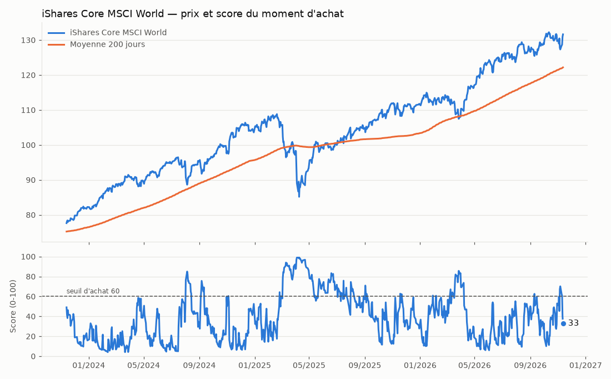

# Tableau de bord — 13/11/2026

⏳ Proposition en attente de votre réponse : ticket #135

Score du moment : **46/100 — 🟡 moment neutre**. iShares Core MSCI World est à -1.4% de son plus haut sur 1 an, +6.7% par rapport à sa moyenne 200 jours, RSI 52.

Historiquement (^GSPC depuis 1950), quand le score était dans la tranche 40-60 : **+8.7% en moyenne 12 mois plus tard**, positif dans 74% des cas (tous jours confondus : +9.3%, 74%).

## Portefeuille suivi

Portefeuille suivi : aucune position ; réserve 0 € ; en attente d'investissement 400 €. Valeur des positions : 0 €.

Apport mensuel : 200 € — proposé dès que le score atteint 60, au plus tard le 20 du mois.

## Statistiques du score

**^GSPC** :

| Score | Jours | Rendement moyen à 3 mois | à 12 mois | Positif à 12 mois | Pire cas à 12 mois |
|---|---:|---:|---:|---:|---:|
| 0-20 (cher) | 2 696 | +2.0% | +11.1% | 81% | -37.1% |
| 20-40 | 4 238 | +2.4% | +9.1% | 76% | -42.2% |
| **40-60 ← aujourd'hui** | 4 367 | +2.6% | +8.7% | 74% | -44.7% |
| 60-80 | 3 995 | +2.2% | +8.3% | 70% | -46.3% |
| 80-100 (soldé) | 3 094 | +1.8% | +10.4% | 71% | -48.8% |
| Tous les jours | 18 390 | +2.2% | +9.3% | 74% | -48.8% |

**Commandes** (en commentaire de n'importe quel ticket) :
- `oui` : j'ai passé les ordres proposés → le bot les enregistre
- `non` : je ne fais rien → le bot repropose dans 7 jours
- `apport 300` : changer l'apport mensuel (en €)
- `capital 2000` : ajouter une somme ponctuelle à investir
- `possede EUNL.DE 12` : déclarer des parts que vous avez déjà
- `aide` : afficher cette aide

#### 🔎 Radar (3063 actions et ETF suivis, 460 soldés aujourd'hui)
- ⭐ **Rohm Co., Ltd.** (action, chercher « Rohm Co., Ltd. ») — score **97/100**, -51% depuis son plus haut ; historiquement à ce niveau : +26% à 12 mois en moyenne, positif 67% des cas (moyenne du titre : +10% ; 8 épisode(s) indépendant(s))
  - 📰 🟠 à vérifier : baisse bien plus forte que le marché, sans article inquiétant trouvé (3 mois : -38% vs marché)
- ⭐ **Droneshield** (action, chercher « Droneshield ») — score **97/100**, -75% depuis son plus haut ; historiquement à ce niveau : +196% à 12 mois en moyenne, positif 88% des cas (moyenne du titre : +83% ; 3 épisode(s) indépendant(s))
  - 📰 🟠 à vérifier : baisse bien plus forte que le marché, 1 article(s) à regarder (3 mois : -39% vs marché)
    - ⚠️ [Short Seller Favourite: Can ASX 200's DroneShield (ASX:DRO) Fight Back? - Kalkine Media](https://news.google.com/rss/articles/CBMisAFBVV95cUxQbjdJWFh2YVIyQUcydVZzc2xEaUl4a1BsUnFyWlo4LXo0T0sxaVl4Nm5wVnIwcS1MU2EzTHFSVTVfck5qYTVZcHJSUWVuUHhnU05LZzdnYzNYV0FTaUpFWC1hVm43d0k2OUVGN1drMkhsX2JVVVY4RmNaYXNSeEdkdlZwLW1NaEVLeGkzR25wRWt3amhTU0lVbFNSdHI5cjhpeEZXWkRnX1ZZT0J6QXFMUQ?oc=5) (short seller)
- ⭐ **Eagers Automotive** (action, chercher « Eagers Automotive ») — score **97/100**, -48% depuis son plus haut ; historiquement à ce niveau : +42% à 12 mois en moyenne, positif 68% des cas (moyenne du titre : +28% ; 7 épisode(s) indépendant(s))
  - 📰 🟠 raisons de la baisse déjà publiées : marges sous pression, réaction excessive du marché (pas une braderie sans raison) (3 mois : -35% vs marché)
    - 📉 [Eagers Automotive stock: EV expansion cushions margin pressure - ad-hoc-news.de](https://news.google.com/rss/articles/CBMivAFBVV95cUxNSlNybThKbUs1OVhyZVhRZDNyYTMzU21hS2lISTFjck9veTJPaEJjei0xUWN5RVZsZkUxS0ZLdE9yZ0pIRFQxd2pFNTNCZ0FnUmh6UFNoY01kaURrTDktNHBxejFua3hYOFVDQ1Q3elROa1hCVmdaTDlxRTUzbE1SRjVpSXVRRmo1eWVkbWU5X3Q2bTdZNUJodGtmYWw1LXlEa1ZrVzR1LXdBdnRVdGt6ZE83SDhJeENSNURfOQ?oc=5) (marges sous pression)
    - 📉 [APE: Record Revenue Is Intact, Margin Pressure Has Reset The Upside - Simply Wall St](https://news.google.com/rss/articles/CBMi0wJBVV95cUxOZUphQXJmLTNsNHdqWWh6UVc0dHRLZzNzZDQxR1A1TG5qS2psNXBISW1hdlRaU2plSFE1aHl5RmZ0eDJ1c3Qwc2xweDhvS0dkaTNJTE55a2gxM19yUkNsQWY0VlhDMkNlcGR6ME52Z3lEb1pfRXloU1pjUzljdm5pc0RUTXREWVJXWVZXWHhJWmRXX3pzOW9URmFTOUJ1N2k4UkNZRWdfMFRKbWxzZW9mMXcxUFVhbWdoeWhyaFVrTkVuV3ViRVhiQ3ExRWpBZjFLM3R0cUhZSjFiTVZ5d04yeTlpWi1SenZadDIzSVdCanVKYWluQnVwRVVsUWF5V2V0RVlTbUdZejNxMWhwNFhRNEliQ0xBY1ZwSWRILUhUVEFaTWNwT3dKRzZDQm8zSGNZbnFGSFpUcUFDLWxWN2t0eGlKekJVN25rYURhRVN0MDdwbTg?oc=5) (marges sous pression)
    - 📉 [How Eagers Automotive (ASX:APE) is leaning on acquisitions as the ASX 200 car retailer faces margin pressure - Kalkine](https://news.google.com/rss/articles/CBMi1wFBVV95cUxPRU1lTWpoLXpONWtqWWdHM2tFUGpTWkh5RXlSRzBnaXpOeEF6NkxYdW0yZVBkWXZpNnpQcHVSZkpxOV9zdU5WbzZYT2pFbkJibUwtT0VQcHQtWVZOcFRJbmFvUU9HWC1meGUtT3NVUTRTV2JMcUtoZDRoVFRlQzJ0QXEySEFmTHl1Y1doRHV1MnZnTG9LcTRTWnVtR0daaWRZalQ5TzM5Vk1kX2E2R0d2cVZUZ2JKeUk4aTI3QVRyZGZOR2VKb0VLenhGM0dWVDFHQUZGU1pqTQ?oc=5) (marges sous pression)
- ⭐ **Sumitomo Electric Industries, Ltd.** (action, chercher « Sumitomo Electric Industries, Ltd. ») — score **97/100**, -56% depuis son plus haut ; historiquement à ce niveau : +41% à 12 mois en moyenne, positif 79% des cas (moyenne du titre : +21% ; 8 épisode(s) indépendant(s))
  - 📰 🟠 à vérifier : baisse bien plus forte que le marché, sans article inquiétant trouvé (3 mois : -29% vs marché)
- ⭐ **Sterling Infrastructure** (action, chercher « Sterling Infrastructure ») — score **96/100**, -71% depuis son plus haut ; historiquement à ce niveau : +70% à 12 mois en moyenne, positif 78% des cas (moyenne du titre : +47% ; 6 épisode(s) indépendant(s))
  - 📰 🟠 raisons de la baisse déjà publiées : réaction excessive du marché, inquiétudes sur les dépenses en IA (pas une braderie sans raison) (3 mois : -52% vs marché)
    - 📉 [Data Center Stocks Just Plunged After the Midterms. Is It Time to Buy the Dip? - The Motley Fool](https://news.google.com/rss/articles/CBMiuwFBVV95cUxOQmo1WnpmM1hvYmdvRnJFelpzN1FlYTFpaVBwci1xOV9fNEFHaGZNelhBNHZWTTZsWndnZy1mY2NDSk9lcVZPb2FLMmJyWTVNUEcwazZqeTVjMnlwR1BNd2ZHZzNsaTc1S1hnX1p3eUw1SjVqdG9ISXYtOXhuNUNBNm9ZbU1ZajVRaEZQOW5nVTRQcEFMZ1ZLVlk2NjBIODRlWjQtWXRxY1IzWkZoSllmcUZXZkxZYkI3dC1Z?oc=5) (réaction excessive du marché)
    - 📉 [Sterling Infrastructure (STRL): Time to Buy the Dip Before Q3 Earnings? - Yahoo Finance](https://news.google.com/rss/articles/CBMipAFBVV95cUxNTVR1emxRRWJPTHlPUmxXZmlNTUh4Rkl5N0ljU0pfOEJWWmZOclpnNDV0ZHNJZ2tJd2JsbnJJQVpuOFdnWjEySTRYaUNfUE84a0praGhQNUdvVTZaRFpoLUZ2eXAtZkM2UFJyeEdXZ1RfeENyOWsxTXlKdjZIOGZ3WVpzcjR1QUNYWEFiaDZmazlrMVNHN0xoVG9SRVdWM3JxTlctMA?oc=5) (réaction excessive du marché)
    - 📉 [Sterling Infrastructure sinks as investors brace for earnings and broader AI infrastructure jitters | STRL Stock News - Quiver Quantitative](https://news.google.com/rss/articles/CBMizAFBVV95cUxOSGFVSlpDaW5ucVhvSzFhT2djc0s0c19RV2tGR3pZMjQ4NlRYLWo0WGxQUDQ1TGU5dF93NEgzRDlFbUFTc1RIVHFzUlFxUnY3LVJJcHRFQjhDQjFIaVBscG5zZHJuZG0yOHJOR3k4V3Vob1FVTVJScmdNSWFlNnVFY0JVOWNNdW1iQXplX1pVeWpzY1RUSGJKQnBuYlc5TFc2dl9ENklQbTlQVHk4Y0RRZlM5X0I0REUtVWtBTjNQcTAxOXhWbGNGUVl0NEc?oc=5) (inquiétudes sur les dépenses en IA)
- ⭐ **Murata Manufacturing Co., Ltd.** (action, chercher « Murata Manufacturing Co., Ltd. ») — score **96/100**, -58% depuis son plus haut ; historiquement à ce niveau : +40% à 12 mois en moyenne, positif 77% des cas (moyenne du titre : +19% ; 6 épisode(s) indépendant(s))
  - 📰 🟠 à vérifier : baisse bien plus forte que le marché, sans article inquiétant trouvé (3 mois : -29% vs marché)
- ⭐ **Intel** (action, chercher « Intel ») — score **95/100**, -58% depuis son plus haut ; historiquement à ce niveau : +33% à 12 mois en moyenne, positif 71% des cas (moyenne du titre : +17% ; 6 épisode(s) indépendant(s))
  - 📰 🟠 raisons de la baisse déjà publiées : repli de tout le secteur, trésorerie sous pression, prévisions décevantes (pas une braderie sans raison) (3 mois : -42% vs marché)
    - 📉 [Intel’s Selloff Is Turning to Range Bound Consolidation - Yahoo Finance](https://news.google.com/rss/articles/CBMinwFBVV95cUxPbGVsenhTYXZOU1poWjRWcDU4cUlkRGJQM1BUb1JMSk0tSlFldkpVc1ZjS3RJMlRldVFTeGlvQmNhU19QN0hNeFRhalp1YVlzU09RZU9HLVRzZ2ZJaUlJQjhORi1qc29zdnFTRU9rSElNWW9GbWI3Y0otMF9fLUxTeWdydE5Qa1lBVzZEYXpnVWZLcFdncEVLRl9yMWl4M0k?oc=5) (repli de tout le secteur)
    - 📉 [Intel: Upgrading To 'Strong Buy' After The 38% Sell-Off (NASDAQ:INTC) - Seeking Alpha](https://news.google.com/rss/articles/CBMiogFBVV95cUxQbVZDRGNjMkxjYmdiUFRKUnc2YzJrUko0Y3Y3cmlmOFFZeHJTSGtwdUJsVVNDbEFpQWh3anYwRmhzSG93TEJVdktpTTdrakpoS3V4T1NXcUtRTlFTMjBET0F2RHpzS1Z3S0xxMnRSLVh5WFVQcmIydnlaMjdzblRDQXRNcDNRanJTUnhGU0xJanFRY1IyMkFrejBTbU9oN04yZWc?oc=5) (repli de tout le secteur)
    - 📉 [Amazon et Intel créent un « sell-off » dans la tech à New York, Sanofi et Imerys dans les plus belles satisfactions du jour à la Bourse de Paris - Investir Les Echos](https://news.google.com/rss/articles/CBMitAJBVV95cUxPNWdwRGpwOEZPa29rUWxJNzB6Yjkwbm8xMWFPM3dTVV84Q3dfaVF1Ui14bWJvM28xTnhIank3UGJYZjBtNlFEMm1uOVYtMkY4YWlXQXE2TDJmUHZ6Vks1Qk5reS11Tzd0NDVfTl95blktNmxtZHNiWGJVMk8xYmQtNkh2UjUxXy1kcFRocm1iUmk4LXJSbTc0bHNIbHRWMmlKZ0w4R0hRWm9MdDVlVWp6LTE4bUhDN2QyNFBfVFcyQkJ0eC14ZVFHdGZZejJMSEkxbEhyODF4UTRPZTR2S2VRVHFNeDJLaHlaaW1TdmRUTVNnQm5pSF9pNUdVNzNhNjhJeXZId0ZBOXh0cW5QQTdSSFgyZFZIdGxWWjgwVnJQbVhBQkk3TkNxUGsyVVBuRG95aW4tXw?oc=5) (repli de tout le secteur)
    - ⚠️ [Key House intel lawmakers urge probe of Huang’s relationship with alleged Chinese spy - Politico](https://news.google.com/rss/articles/CBMif0FVX3lxTE9NNUtDWjBYaW5EbFd0ZmVHLXBhYWlaZEo1SGh1bzJiNU5BSkVyc0NaSzY0VkdWVDd1X0ZMOUZpcHlNR1l3Y2hHRC1sNTVMeFRlOVRtWVdHSmVmejVkS2hkVWx4dklEYXZ5MTdPTUd3c2IyQUhqX05zdE1NNHNfNEE?oc=5) (probe)
- ⭐ **National Health Investors, Inc.** (action, chercher « National Health Investors, Inc. ») — score **95/100**, -28% depuis son plus haut ; historiquement à ce niveau : +26% à 12 mois en moyenne, positif 93% des cas (moyenne du titre : +16% ; 5 épisode(s) indépendant(s))
  - 📰 🟢 rien d'alarmant dans l'actualité (4 article(s) mineur(s), courant pour une grande entreprise) (3 mois : -11% vs marché)
    - 📉 [Wells Fargo Maintains National Health Investors Inc(NHI.US) With Hold Rating, Cuts Target Price to $68 - 富途牛牛](https://news.google.com/rss/articles/CBMirwFBVV95cUxNRjl1UHlHYTczQmdhcllpazdvbWJPRDZqamhDMmtRcndDTDk5MnZGS1B4TjRkWEFhT0tHbmlqYkg3MWZmM2M2bTFnMkFEOTc0c0xZRVYtUXBpU2FRc25SY2I0dG9zcGVfRWFXRFd5NGJQY3dia212OFNjbXEyb1FsWUxsdzgxSGpHNFExRnZkV0J6d0VwZ2lka1psbHpBaVNRSVhpZjRNLUI5MTNyY21V?oc=5) (objectifs de cours abaissés)
    - ⚠️ [National Health downgraded by BofA Securities with a new price target - Quantisnow](https://news.google.com/rss/articles/CBMiqAFBVV95cUxNeHV5ZS1TX3AyaVd2M2hIcnhpZnFfdWxOTEpTQ0ZHWTYxdnQ0cEg3NUE1RVg4enZNWkZZYlNpbmlLa0FiSEdYeFRCakxEdW44d21QTHVFYTFONnlZMU9oNlN5M004cGItOUV5QVRtRWlOX0ZETlVuaGd0YnJtTGRVYk5VZVBIb1l1dWhibkJsNllJUEhIOTdrTWJQOGFWLVpYZVhodEhZR0k?oc=5) (downgraded)
    - ⚠️ [National Health Investors (NYSE:NHI) Downgraded by Bank of America to Underperform - MarketBeat](https://news.google.com/rss/articles/CBMi2gFBVV95cUxQX3FvZHdPLWo0VFE0ZXB3cjdWVC0xNjRlT2dpcHJaaFdyM2IwSUlhd3Q5MFd5dUUzaTQ2bWdDWktNTWZWbmhqdkdyMzVjNHlaY2RtZ2Zfc3ZaalVNOVp2MmJuZHk3eXhWV095Tm9sWDVyNGd0VEVjcXhzY1pubUduY0d5eW1DRDUyMm9GN3pwRTJwVjhUOWRnWEp2RGptOENzbGI3eFlQNmowRTRsR2llV0x3dFJjWC1Ha2JyOFE0SUdxV0xtR0o5U0dGMUFqU2VKMmpGS19JRl90Zw?oc=5) (downgraded)
    - ⚠️ [National Health Investors (NYSE:NHI) Hits New 1-Year Low on Analyst Downgrade - MarketBeat](https://news.google.com/rss/articles/CBMi0AFBVV95cUxPcmIweUc0Q3lsanZYaFhUV0lkdHVwUzFYZDJESGFZTjZIcTk2dWxyVUMtZ0RxT3MxdzBTUHJJVVBLQVg0NFgyc2tGbU5PbmNRbko5Z29YanZmaHZ4Z3BLSFk4LTh2azJjYmo2b2d6ckdjMVh4UnlSR200T3g5eGpCQzItOWVvLVA0b0p2WDVUYllFbGkzcDE1RFd3eUhFenVHbU5FajFuZGhkaC1UZm5sdWRWNTJOTzBxTjZqN1RiVzAxdi0xR0tnVVB3M29oWnBI?oc=5) (downgrade)
- ⭐ **SCREEN Holdings** (action, chercher « SCREEN Holdings ») — score **95/100**, -56% depuis son plus haut ; historiquement à ce niveau : +34% à 12 mois en moyenne, positif 65% des cas (moyenne du titre : +27% ; 8 épisode(s) indépendant(s))
  - 📰 🟠 à vérifier : baisse bien plus forte que le marché, sans article inquiétant trouvé (3 mois : -35% vs marché)
- ⭐ **Adeia, Inc.** (action, chercher « Adeia, Inc. ») — score **95/100**, -52% depuis son plus haut ; historiquement à ce niveau : +27% à 12 mois en moyenne, positif 65% des cas (moyenne du titre : +14% ; 6 épisode(s) indépendant(s))
  - 📰 🟠 raisons de la baisse déjà publiées : valorisation jugée trop élevée (pas une braderie sans raison) (3 mois : -45% vs marché)
    - 📉 [FMR LLC Adds 2.26 Million Adeia Inc (ADEA) Shares -- Stock Looks 5% Overvalued on GF Value - GuruFocus](https://news.google.com/rss/articles/CBMivwFBVV95cUxObE5QR2FjNkp3eU9YSDhNVlJvSmljRVBRQWhVdjBZVGZfRjR5RmxLOGJScDl1U3JwOHNhcWQxWlhid0FVVGRXdmd2ZVA5MEtuaUx6Z1JBcGFLbXBjalpSc3d1Rk9sTEE1NlhoOUhzX0tvSVpoVWNzbEltY1pETldwVnlIbXR1QkVlTE5HWWZTd0R4SjEyRkw1YjNNVDJJZXROeTdiZHI1aFk1UkRJQkFaVkZCeHlYVi1heFZKbWY4dw?oc=5) (valorisation jugée trop élevée)
    - 📉 [Is Adeia Inc (ADEA) Overvalued After 5.9% Rally? GF Value Says O - GuruFocus](https://news.google.com/rss/articles/CBMiqwFBVV95cUxNNlBJcUgzbkdmSEkxUnlZZlB1cmV4ZEJxbHR5QjVKWWs4M2NValJhUk5UTnhqT1JrNWRwT1pNejVvWTd3TjFNeG95aHV6TkhsT2I0RWpna3dnSldCY29tS2VoQzVyZ1BzZUhfZjdxT3I1ZUYtVUNwam1pYm1xN0ZMb1lWNmZwUFhOOWhGUTBLQ0tIZW5mSW1Ba1YwTXJULVhiRUd3Mlk1eUVGakk?oc=5) (valorisation jugée trop élevée)
    - 📉 [Adeia Inc (ADEA) Stock Up 3.1% but GF Value Says Overvalued -- G - GuruFocus](https://news.google.com/rss/articles/CBMirgFBVV95cUxOWEs3NTdmM3JMWWVzNFhZNk11UG4xamJDRk9GTUJydnczNTNPbGJuWG9wUW1sLUpLZHBNaVc4MnBFdUhKcDd4Y3JCUF9nczBHTERQRzBJN25tdnZGSnlvbFpsYWtHMTRnMTZhR3o4R2ZYUjlVRFA2NHltVl9pRUhSZ0g0WkhORWhaRHpRZ0lBTkRBMWFOcTdiT0tXN0pQa3k0dEJWOG96elFUTGo1VWc?oc=5) (valorisation jugée trop élevée)
    - ⚠️ [Adeia Investigation Notice: SueWallSt Notifies Investors of Pending Investigation Into Adeia (ADEA) - Morningstar](https://news.google.com/rss/articles/CBMi7gFBVV95cUxOVkFYSGhrX1NHa1Z5NW9sLVg1c1J0STI4alhfTUNkYWxYVHBfUFE3aEpJdjJsNjI1RjhOZkIyY2p1SzlMMFUwR0ZYWFRaOWNIS3B3V05wNjYwVTVGQXNrNW8wckFXZWFZWWlKb2xNRlp2LTZTNF9XaE1EMDhpRVYzaHNSQ2ZmNzNYUWZic2twNUpJU2M1S1dLTGFMZF9Jc3JHdTNrLXY3S2szaS16bnRYVld4UGRTSnhZSEJPZ2dMZks4bXJvZ1hHNXQ1YUprM0dMMFhRbHNPcEF4QVNqenBYTDhTM0lUMV9EdW5iX0tR?oc=5) (investigation)
- ⭐ **Caterpillar Inc.** (action, chercher « Caterpillar Inc. ») — score **95/100**, -43% depuis son plus haut ; historiquement à ce niveau : +32% à 12 mois en moyenne, positif 76% des cas (moyenne du titre : +24% ; 7 épisode(s) indépendant(s))
  - 📰 🟠 raisons de la baisse déjà publiées : droits de douane, réaction à une acquisition, résultats sous les attentes (pas une braderie sans raison) (3 mois : -31% vs marché)
    - 📉 [Weekly Recap: Q3 growth, record backlog and capacity limits, tariff costs - TradingView](https://news.google.com/rss/articles/CBMiywFBVV95cUxPRTM0bVVUNTQwQTFFdVc2RVBGbG9XNGw4SWxpWVRwUldQdERxN0dTVHVRMGx3SzhPWnoxa0FYVlpkSjNVVWhMTUMzaVRQWWZPRmFJV1VndHNfZHFmZ09KaWQydDVodW55YXQ0R0VYX3kzQ29lSVE2aTdCSFkxV3BRbG9td2pKX2pKa2psX1RNUG1zbHQzSnVXLUtzQThabDhybkVyekpsU1lKQ0FOMEFSTllDcEs0S1l2eVRoOEdRbHlmeDVJTnhVekdnVQ?oc=5) (droits de douane)
    - 📉 [Caterpillar boucle le rachat de son concessionnaire Fabick - Zonebourse](https://news.google.com/rss/articles/CBMiuwFBVV95cUxPUkJDZ2ZXQTIydmxHN2ZOWmk5MVB0RExJUEZzWUhVYXIyVUFoTzltbWlqMEZVa3dKTnhQZ0o3SVVSaGxEQVExTUJWSGhDdXdDckdaVW44ZTZyU0R4NTl3WEJhZEZqRWs3THc5WFd6Rkp6Y3p5ZlRPWER2Y1R2T3NLLU4zVGpubWxwaWZZOWVYR3ZGMkUwT3hJemZ3dnMtTVZCRm8wanBTZGdmMnVvYV9xVUZWb1NjaTYwNkVv?oc=5) (réaction à une acquisition)
    - 📉 [Caterpillar Stock Tumbles Despite Q3 Earnings Beat As Revenue Falls Short Of Estimates - TradingView](https://news.google.com/rss/articles/CBMi3wFBVV95cUxOVDRQQmNFcXhxTHZXbExyS2UySzEtQldzSDdkZkRLdmpfSDZ1NjRvT2o5MVRxQzNrWkRDQldKbzdqeVZqdzFFVVR6QnhCS3JoakNlYWFjd0VSbmtkUFJqb2FiYVhESU43cDc3bDJ1VlI1TTZ4d3dVMHRrSGdTNWU0d0pHSk9vVFh0MHdsUWJ5bDBRLVRCQnpvdFp5Y2t1UlRPQ0VXdlpjcXM2WENkQ1BONDNSeVpuR1BqeW9FNi1OOWVsUlJXUUQ5MTNkZHg1SVZxZE1Nem1SdFZRbHdKNUV3?oc=5) (résultats sous les attentes, recul malgré de bons résultats)
    - ⚠️ [Investigation launched into Caterpillar for pos... - Pluang](https://news.google.com/rss/articles/CBMirwFBVV95cUxPRzVPNXdndG13V3Y3eTdBNG93d3dRMk9qNXNLMXhkVHhxUHhrb1poSVQxY3V4WjQwVHhaX29nTUIxVGY5UkxGMmtHeVVPSW5rSzdZdzZKdGhrTFR0VUZkNWVBdnh1QWY0X0dfb0NXbkc4TFMwTzhRR3JYQ3J1MDhTV3RGdUJUWUE0UW92WVVPelk2LW40WkhnSHdSN2JQb0ZLUEIweU5JZjR0bk4taEF3?oc=5) (investigation)
- ⭐ **EnerSys** (action, chercher « EnerSys ») — score **95/100**, -41% depuis son plus haut ; historiquement à ce niveau : +47% à 12 mois en moyenne, positif 82% des cas (moyenne du titre : +20% ; 5 épisode(s) indépendant(s))
  - 📰 🟠 raisons de la baisse déjà publiées : objectifs de cours abaissés, résultats sous les attentes, réaction à une acquisition (pas une braderie sans raison) (3 mois : -28% vs marché)
    - 📉 [Oppenheimer maintains EnerSys at Outperform, lowers price target to $210 from $250 - TradingView](https://news.google.com/rss/articles/CBMi2AFBVV95cUxPbG91WEZPQkN0QnZnUTBLY3lHY3hlSEgydklGM3h5bW1RcC1IbHhFMDhOMG8xV2V3bmg5QjdWLWFYSkF2VUZfYlRiOEtuN1BkVUlhUVdKa0I3TVE1NlNmNnhPUlhZOFBONlU5NXBxdXA5TkJnalVEa0ZoVzlscUxlUUtscGFNdGlvNXZsOUtyVHQ5bUZjeTB0ckpKR3ZlSVhrNHR1Y21LcnRhbXlBYXZBSl9XelRlOWtneGVFZEpnRGY1MFJCeDdyMHVibXAyVDhlY3hzb3NGYmM?oc=5) (objectifs de cours abaissés)
    - 📉 [EnerSys Q2 revenue steady at $950M; EPS up 23%, Oppenheimer cuts price target to $210 - Pluang](https://news.google.com/rss/articles/CBMihwFBVV95cUxOaGNqWFFfd2hXY3VXRVNWV3VJZGd5VHBoVHBxaXdVQ1hSOVVaM3lZbVUzUmhoZi1lTTVraERRWnJndGxhZXJaWHp2dHdtRW9pWFVtYk9scE9TZzM2d0F3b0Z2ZVlMbURteGFOQkRkQzBfQ19VazZxQWhKY1FBTm5MbUgyUDdsNEE?oc=5) (objectifs de cours abaissés)
    - 📉 [BTIG cuts EnerSys stock price target to $250 on revenue miss By Investing.com - Investing.com India](https://news.google.com/rss/articles/CBMivAFBVV95cUxPYW5HX090ZmNUVzJXQXo1Yl9VZEZteDQzRGp5enYwamtaWmZZSVBjWjZWdWpUeERjNmVjMkxKZ3RILWtUNTNJQzlPNEZQdVpnS0Q2MDBCSlA4MlJXMkhiZXBxSDB5VTY4dGFQQzJWalJkaUtWRkdqdE96em5MaGt4Mm5PMVlDejZEdmFqNXY5a3ZlbkRiOEh5a29lMzd1MjR2TFdpZkYweXRQMW14Rlowa05HdlpIdk9EMG9WOA?oc=5) (résultats sous les attentes)
- ⭐ **Sumitomo Metal Mining Co., Ltd.** (action, chercher « Sumitomo Metal Mining Co., Ltd. ») — score **95/100**, -43% depuis son plus haut ; historiquement à ce niveau : +37% à 12 mois en moyenne, positif 76% des cas (moyenne du titre : +21% ; 7 épisode(s) indépendant(s))
  - 📰 🟠 raisons de la baisse déjà publiées : coûts en hausse (pas une braderie sans raison) (3 mois : -27% vs marché)
    - 📉 [Sumitomo Metal Mining: Metal gains lifted H1 profit, but CBNC impairment and cost pressures cut the FY outlook - TradingView](https://news.google.com/rss/articles/CBMimgJBVV95cUxNQnVZOXFNUkZUZEN0MGVkWWhLWF93ZWdUUlB2bUY3cVJNcXZvMmVsWVNmeXJjaUZwQ01vTTFEMmM3RWpOeGlQaXU0U3J4SVkwWUZUTV9ocjRMRW1LRy1Kbnl0Q21ZNWpSVFNRdW1sVGRmVzRoWk9VNnVoMko2OW9mVGZyQXJEYTdqU3laUVg1Z0s4WHhFSVVCSXIwaGVsVEMzWHpLd3lnWlgtTEpMLVdfM0ltTnowaVF2VnZqeGx3MkRtUzFiZV8wckdhTEszUmFIYXItRklMNHdBZnZWd2o4UW8zb0h0NmNGbHk5c19qaDkxLUsyc1laNzMwWGwzbUFXMzVnRnFkRTdvc0dpM3FOMGE2Z2lORTlIWUE?oc=5) (coûts en hausse)
- ⭐ **The Furukawa Electric Co., Ltd.** (action, chercher « The Furukawa Electric Co., Ltd. ») — score **94/100**, -64% depuis son plus haut ; historiquement à ce niveau : +46% à 12 mois en moyenne, positif 53% des cas (moyenne du titre : +30% ; 6 épisode(s) indépendant(s))
- ⭐ **Universal Corporation** (action, chercher « Universal Corporation ») — score **94/100**, -32% depuis son plus haut ; historiquement à ce niveau : +21% à 12 mois en moyenne, positif 76% des cas (moyenne du titre : +8% ; 5 épisode(s) indépendant(s))
- ⭐ **Kaiser Aluminum Corporation** (action, chercher « Kaiser Aluminum Corporation ») — score **94/100**, -44% depuis son plus haut ; historiquement à ce niveau : +35% à 12 mois en moyenne, positif 74% des cas (moyenne du titre : +16% ; 4 épisode(s) indépendant(s))
- ⭐ **BWX Technologies** (action, chercher « BWX Technologies ») — score **94/100**, -48% depuis son plus haut ; historiquement à ce niveau : +29% à 12 mois en moyenne, positif 83% des cas (moyenne du titre : +23% ; 3 épisode(s) indépendant(s))
- ⭐ **Otter Tail Corporation** (action, chercher « Otter Tail Corporation ») — score **93/100**, -19% depuis son plus haut ; historiquement à ce niveau : +19% à 12 mois en moyenne, positif 91% des cas (moyenne du titre : +11% ; 6 épisode(s) indépendant(s))
- ⭐ **Comfort Systems USA** (action, chercher « Comfort Systems USA ») — score **93/100**, -46% depuis son plus haut ; historiquement à ce niveau : +95% à 12 mois en moyenne, positif 92% des cas (moyenne du titre : +42% ; 8 épisode(s) indépendant(s))
- ⭐ **SLM Corp** (action, chercher « SLM Corp ») — score **93/100**, -43% depuis son plus haut ; historiquement à ce niveau : +15% à 12 mois en moyenne, positif 56% des cas (moyenne du titre : +13% ; 7 épisode(s) indépendant(s))
- ⭐ **Texas Pacific Land Corporation** (action, chercher « Texas Pacific Land Corporation ») — score **93/100**, -46% depuis son plus haut ; historiquement à ce niveau : +46% à 12 mois en moyenne, positif 75% des cas (moyenne du titre : +41% ; 6 épisode(s) indépendant(s))
- ⭐ **TFI International Inc.** (action, chercher « TFI International Inc. ») — score **93/100**, -39% depuis son plus haut ; historiquement à ce niveau : +31% à 12 mois en moyenne, positif 60% des cas (moyenne du titre : +25% ; 6 épisode(s) indépendant(s))
- ⭐ **Norsk Hydro** (action, ISIN `NO0005052605`) — score **93/100**, -43% depuis son plus haut ; historiquement à ce niveau : +22% à 12 mois en moyenne, positif 61% des cas (moyenne du titre : +20% ; 5 épisode(s) indépendant(s))
- ⭐ **ESCO Technologies Inc.** (action, chercher « ESCO Technologies Inc. ») — score **93/100**, -35% depuis son plus haut ; historiquement à ce niveau : +17% à 12 mois en moyenne, positif 72% des cas (moyenne du titre : +16% ; 7 épisode(s) indépendant(s))
- ⭐ **SoftBank Group** (action, ISIN `JP3436100006`) — score **93/100**, -59% depuis son plus haut ; historiquement à ce niveau : +57% à 12 mois en moyenne, positif 79% des cas (moyenne du titre : +34% ; 6 épisode(s) indépendant(s))
- ⭐ **Avino Silver & Gold Mines Ltd.** (action, chercher « Avino Silver & Gold Mines Ltd. ») — score **93/100**, -60% depuis son plus haut ; historiquement à ce niveau : +46% à 12 mois en moyenne, positif 55% des cas (moyenne du titre : +40% ; 5 épisode(s) indépendant(s))
- ⭐ **Kratos Defense & Security Solutions** (action, chercher « Kratos Defense & Security Solutions ») — score **92/100**, -74% depuis son plus haut ; historiquement à ce niveau : +31% à 12 mois en moyenne, positif 60% des cas (moyenne du titre : +14% ; 7 épisode(s) indépendant(s))
- ⭐ **Powell Industries, Inc.** (action, chercher « Powell Industries, Inc. ») — score **92/100**, -56% depuis son plus haut ; historiquement à ce niveau : +42% à 12 mois en moyenne, positif 75% des cas (moyenne du titre : +31% ; 6 épisode(s) indépendant(s))
- ⭐ **Winmark** (action, chercher « Winmark ») — score **92/100**, -43% depuis son plus haut ; historiquement à ce niveau : +35% à 12 mois en moyenne, positif 84% des cas (moyenne du titre : +22% ; 8 épisode(s) indépendant(s))
- ⭐ **Western Digital** (action, chercher « Western Digital ») — score **92/100**, -60% depuis son plus haut ; historiquement à ce niveau : +77% à 12 mois en moyenne, positif 83% des cas (moyenne du titre : +44% ; 7 épisode(s) indépendant(s))
- ⭐ **Zijin Mining** (action, chercher « Zijin Mining ») — score **92/100**, -40% depuis son plus haut ; historiquement à ce niveau : +35% à 12 mois en moyenne, positif 66% des cas (moyenne du titre : +29% ; 6 épisode(s) indépendant(s))
- ⭐ **Curtiss-Wright** (action, chercher « Curtiss-Wright ») — score **91/100**, -40% depuis son plus haut ; historiquement à ce niveau : +23% à 12 mois en moyenne, positif 78% des cas (moyenne du titre : +22% ; 7 épisode(s) indépendant(s))
- ⭐ **Fabrinet** (action, chercher « Fabrinet ») — score **91/100**, -56% depuis son plus haut ; historiquement à ce niveau : +82% à 12 mois en moyenne, positif 96% des cas (moyenne du titre : +37% ; 4 épisode(s) indépendant(s))
- ⭐ **Napco Security Technologies** (action, chercher « Napco Security Technologies ») — score **91/100**, -35% depuis son plus haut ; historiquement à ce niveau : +46% à 12 mois en moyenne, positif 74% des cas (moyenne du titre : +31% ; 6 épisode(s) indépendant(s))
- ⭐ **Hecla Mining** (action, chercher « Hecla Mining ») — score **91/100**, -59% depuis son plus haut ; historiquement à ce niveau : +50% à 12 mois en moyenne, positif 61% des cas (moyenne du titre : +27% ; 7 épisode(s) indépendant(s))
- ⭐ **TJX Companies** (action, chercher « TJX Companies ») — score **91/100**, -20% depuis son plus haut ; historiquement à ce niveau : +34% à 12 mois en moyenne, positif 94% des cas (moyenne du titre : +19% ; 6 épisode(s) indépendant(s))
- ⭐ **BorgWarner** (action, chercher « BorgWarner ») — score **91/100**, -34% depuis son plus haut ; historiquement à ce niveau : +22% à 12 mois en moyenne, positif 65% des cas (moyenne du titre : +17% ; 7 épisode(s) indépendant(s))
- ⭐ **Carpenter Technology** (action, chercher « Carpenter Technology ») — score **91/100**, -53% depuis son plus haut ; historiquement à ce niveau : +38% à 12 mois en moyenne, positif 67% des cas (moyenne du titre : +35% ; 7 épisode(s) indépendant(s))
- ⭐ **IG Group** (action, chercher « IG Group ») — score **91/100**, -50% depuis son plus haut ; historiquement à ce niveau : +21% à 12 mois en moyenne, positif 75% des cas (moyenne du titre : +12% ; 5 épisode(s) indépendant(s))
- ⭐ **Annaly Capital Management** (action, chercher « Annaly Capital Management ») — score **91/100**, -23% depuis son plus haut ; historiquement à ce niveau : +15% à 12 mois en moyenne, positif 73% des cas (moyenne du titre : +9% ; 7 épisode(s) indépendant(s))
- ⭐ **Pan American Silver Corp.** (action, chercher « Pan American Silver Corp. ») — score **91/100**, -42% depuis son plus haut ; historiquement à ce niveau : +26% à 12 mois en moyenne, positif 54% des cas (moyenne du titre : +19% ; 3 épisode(s) indépendant(s))
- ⭐ **Sempra** (action, chercher « Sempra ») — score **91/100**, -19% depuis son plus haut ; historiquement à ce niveau : +16% à 12 mois en moyenne, positif 84% des cas (moyenne du titre : +14% ; 4 épisode(s) indépendant(s))
- ⭐ **NexGen Energy Ltd.** (action, chercher « NexGen Energy Ltd. ») — score **91/100**, -41% depuis son plus haut ; historiquement à ce niveau : +56% à 12 mois en moyenne, positif 63% des cas (moyenne du titre : +36% ; 3 épisode(s) indépendant(s))
- ⭐ **Axon Enterprise** (action, chercher « Axon Enterprise ») — score **91/100**, -51% depuis son plus haut ; historiquement à ce niveau : +33% à 12 mois en moyenne, positif 63% des cas (moyenne du titre : +31% ; 8 épisode(s) indépendant(s))
- ⭐ **Mercury General** (action, chercher « Mercury General ») — score **91/100**, -22% depuis son plus haut ; historiquement à ce niveau : +21% à 12 mois en moyenne, positif 68% des cas (moyenne du titre : +12% ; 5 épisode(s) indépendant(s))
- ⭐ **Lenovo** (action, chercher « Lenovo ») — score **90/100**, -53% depuis son plus haut ; historiquement à ce niveau : +53% à 12 mois en moyenne, positif 62% des cas (moyenne du titre : +22% ; 8 épisode(s) indépendant(s))
- ⭐ **Aurubis** (action, chercher « Aurubis ») — score **90/100**, -37% depuis son plus haut ; historiquement à ce niveau : +24% à 12 mois en moyenne, positif 72% des cas (moyenne du titre : +20% ; 6 épisode(s) indépendant(s))
- ⭐ **Alphabet Inc. (Class C)** (action, chercher « Alphabet Inc. (Class C) ») — score **90/100**, -27% depuis son plus haut ; historiquement à ce niveau : +30% à 12 mois en moyenne, positif 75% des cas (moyenne du titre : +23% ; 6 épisode(s) indépendant(s))
- ⭐ **Ebara Corp.** (action, chercher « Ebara Corp. ») — score **90/100**, -47% depuis son plus haut ; historiquement à ce niveau : +39% à 12 mois en moyenne, positif 80% des cas (moyenne du titre : +22% ; 8 épisode(s) indépendant(s))
- ⭐ **Flex Ltd.** (action, chercher « Flex Ltd. ») — score **90/100**, -54% depuis son plus haut ; historiquement à ce niveau : +72% à 12 mois en moyenne, positif 74% des cas (moyenne du titre : +21% ; 8 épisode(s) indépendant(s))
- ⭐ **First Majestic Silver Corp.** (action, chercher « First Majestic Silver Corp. ») — score **90/100**, -55% depuis son plus haut ; historiquement à ce niveau : +86% à 12 mois en moyenne, positif 48% des cas (moyenne du titre : +58% ; 5 épisode(s) indépendant(s))
- ⭐ **Argan, Inc.** (action, chercher « Argan, Inc. ») — score **90/100**, -62% depuis son plus haut ; historiquement à ce niveau : +67% à 12 mois en moyenne, positif 79% des cas (moyenne du titre : +39% ; 9 épisode(s) indépendant(s))
- ⭐ **TTM Technologies** (action, chercher « TTM Technologies ») — score **90/100**, -67% depuis son plus haut ; historiquement à ce niveau : +60% à 12 mois en moyenne, positif 84% des cas (moyenne du titre : +24% ; 8 épisode(s) indépendant(s))
- ⭐ **The Andersons, Inc.** (action, chercher « The Andersons, Inc. ») — score **90/100**, -31% depuis son plus haut ; historiquement à ce niveau : +31% à 12 mois en moyenne, positif 70% des cas (moyenne du titre : +24% ; 5 épisode(s) indépendant(s))
- ⭐ **Seagate Technology** (action, chercher « Seagate Technology ») — score **90/100**, -52% depuis son plus haut ; historiquement à ce niveau : +90% à 12 mois en moyenne, positif 75% des cas (moyenne du titre : +46% ; 8 épisode(s) indépendant(s))
- ⭐ **AeroVironment** (action, chercher « AeroVironment ») — score **90/100**, -70% depuis son plus haut ; historiquement à ce niveau : +27% à 12 mois en moyenne, positif 72% des cas (moyenne du titre : +21% ; 4 épisode(s) indépendant(s))
- ⭐ **Vale (Brésil)** (action, ISIN `US91912E1055`) — score **90/100**, -35% depuis son plus haut ; historiquement à ce niveau : +30% à 12 mois en moyenne, positif 52% des cas (moyenne du titre : +21% ; 3 épisode(s) indépendant(s))
- ⭐ **Alphabet (Google)** (action, ISIN `US02079K3059`) — score **89/100**, -26% depuis son plus haut ; historiquement à ce niveau : +30% à 12 mois en moyenne, positif 75% des cas (moyenne du titre : +23% ; 6 épisode(s) indépendant(s))
- ⭐ **AGC Inc.** (action, chercher « AGC Inc. ») — score **89/100**, -38% depuis son plus haut ; historiquement à ce niveau : +23% à 12 mois en moyenne, positif 69% des cas (moyenne du titre : +10% ; 8 épisode(s) indépendant(s))
- ⭐ **TDK Corp.** (action, chercher « TDK Corp. ») — score **89/100**, -43% depuis son plus haut ; historiquement à ce niveau : +23% à 12 mois en moyenne, positif 72% des cas (moyenne du titre : +17% ; 7 épisode(s) indépendant(s))
- ⛔ **Gildan Activewear Inc.** écarté : problème sérieux : 2 article(s) grave(s) (fraud, class action) (3 mois : -38% vs marché)
- ⛔ **Cummins** écarté : problème sérieux : 5 article(s) grave(s) (scandale) (3 mois : -28% vs marché)
- … et 398 autres.
⭐ = historiquement, acheter ce titre à ce niveau de score a fait mieux que sa moyenne.
